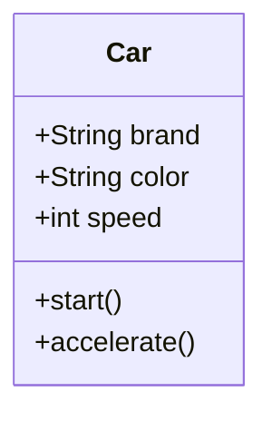
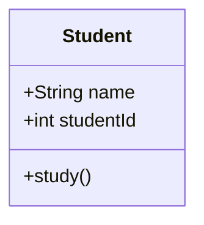
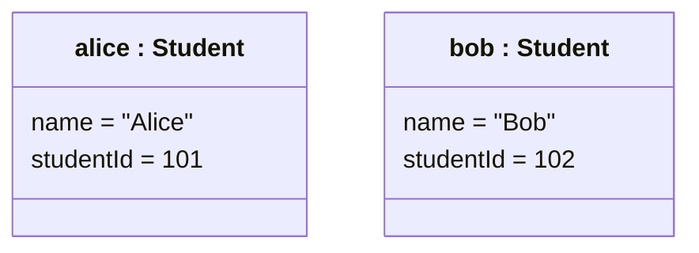
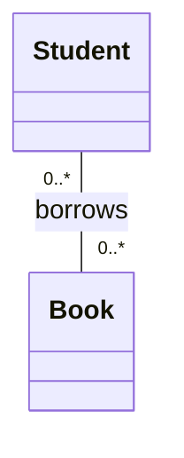
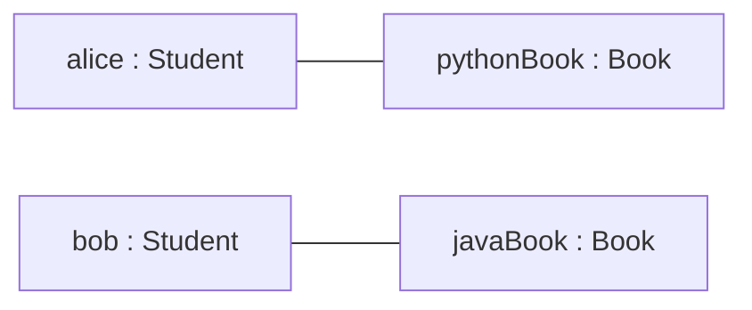
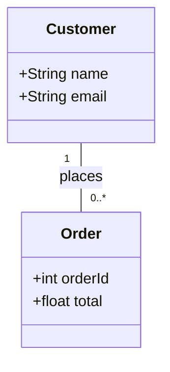
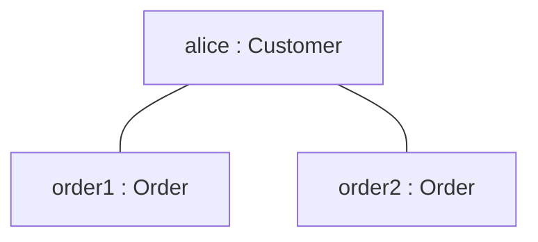

# 02 — Classes vs. Objects in UML

## 1. What Is a Class?

A **class** is a blueprint used to create objects.

It describes:

- **Attributes:** What information an object stores.
- **Methods:** What actions an object can perform.

Think about a car factory.

Before producing cars, engineers create a design that describes their common structure and behavior.

For example, every car might have:

- A brand
- A color
- A speed
- The ability to start
- The ability to accelerate

The design is like a **class**.

The actual cars produced from that design are **objects**.

### A Simple UML Class Diagram



The rectangle represents the `Car` class.

It has three sections:

1. **Class name:** `Car`
2. **Attributes:** `brand`, `color`, and `speed`
3. **Methods:** `start()` and `accelerate()`

The `+` symbol means **public visibility**.

We will learn more about visibility in the Class Diagram chapter.

---

## 2. What Is an Object?

An **object** is an instance of a class.

In other words, an object is something created using a class.

Imagine that a factory produces three cars:

| Object | Brand | Color | Speed |
|---|---|---|---|
| `car1` | Toyota | Red | 0 |
| `car2` | BMW | Black | 60 |
| `car3` | Tesla | White | 30 |

All three cars are created from the same class: `Car`.

However, each object has its own attribute values.

For example:

- `car1.color` is `"Red"`.
- `car2.color` is `"Black"`.
- `car3.color` is `"White"`.

**Important:** A class defines the structure. An object has its own identity and state.

---

## 3. Classes and Objects in Python

Let's create a `Car` class in Python.

```python
class Car:
    def __init__(self, brand, color):
        self.brand = brand
        self.color = color
        self.speed = 0

    def start(self):
        print(f"{self.brand} started.")

    def accelerate(self, amount):
        self.speed += amount
```

Now we can create objects from this class:

```python
car1 = Car("Toyota", "Red")
car2 = Car("BMW", "Black")
car3 = Car("Tesla", "White")
```

Here:

- `Car` is the class.
- `car1`, `car2`, and `car3` refer to objects.
- Each object stores its own values.

Let's use the objects:

```python
car1.start()
car1.accelerate(20)

car2.accelerate(60)

print(car1.speed)
print(car2.speed)
print(car3.speed)
```

Output:

```text
Toyota started.
20
60
0
```

Notice that changing the speed of `car1` does not change the speed of the other cars.

Each object has its own state.

---

## 4. What Is an Instance?

You will often hear these two expressions:

- "Create an object."
- "Create an instance of a class."

They mean essentially the same thing in this context.

For example:

```python
car1 = Car("Toyota", "Red")
```

This creates an instance of the `Car` class.

We can check its type:

```python
print(isinstance(car1, Car))
```

Output:

```text
True
```

The function `isinstance()` checks whether an object is an instance of a particular class or one of its subclasses.

---

## 5. Class Diagram vs. Object Diagram

This is one of the most important differences in UML.

### Class Diagram

A Class Diagram describes the **general structure** of classes.

For example:



This diagram tells us that a student has a name, an ID, and an operation called `study()`.

But it does not tell us which students currently exist.

### Object Diagram

An Object Diagram shows **specific objects and their attribute values at a particular moment**.

For example, imagine two students:

- Alice, with ID 101
- Bob, with ID 102

A simplified representation of their objects is:



This Mermaid diagram is an approximation of UML object notation.

In formal UML Object Diagrams, an object's name and type are normally underlined, and its attributes are displayed with their current values.

Mermaid's `classDiagram` does not fully support all UML Object Diagram notation.

### Key Difference

| Class Diagram | Object Diagram |
|---|---|
| Shows classes | Shows specific objects |
| Defines attributes | Shows actual attribute values |
| Describes possible relationships | Shows links between existing objects |
| Represents the general structure | Represents a particular snapshot |
| Example: `Student` | Example: `alice:Student` |

**Remember:** Class Diagram = blueprint. Object Diagram = a snapshot of real objects.

---

## 6. Object Identity vs. Object State

Two objects can have exactly the same attribute values and still be different objects.

Consider:

```python
car1 = Car("Toyota", "Red")
car2 = Car("Toyota", "Red")
```

Both cars have:

- The same brand
- The same color
- The same initial speed

But they are not the same object.

```python
print(car1 is car2)
```

Output:

```text
False
```

Why?

Because Python created two separate objects.

Now consider:

```python
car3 = car1

print(car3 is car1)
```

Output:

```text
True
```

Here, `car3` is another reference to the same object as `car1`.

No new car was created.

### Important Terms

- **Identity:** Which specific object it is.
- **State:** The current values stored by the object.
- **Behavior:** The actions the object can perform.

These three concepts help us understand object-oriented programming and UML modeling.

---

## 7. Associations and Links

Let's use a library example.

A student can borrow books.

At the class level, we can represent this relationship using an Association:



This diagram describes a possible relationship between the `Student` and `Book` classes.

Now imagine:

- Alice is a student.
- Bob is another student.
- Alice borrowed a Python book.
- Bob borrowed a Java book.

At the object level, we can show specific links between these objects.



This Mermaid flowchart illustrates the object connections but is not a formal UML Object Diagram.

### What Is a Link?

A **Link** is an instance of an Association.

The difference is simple:

- **Association:** A relationship between classes.
- **Link:** A relationship between specific objects.

For example:

`Student -- Book` is an Association.

`alice -- pythonBook` is a Link.

---

## 8. A Complete Real-World Example: Online Shopping

Imagine an online shop with customers and orders.

At the class level:



This means:

- A customer can place zero or many orders.
- Every order belongs to exactly one customer.

Now let's create real objects in Python.

```python
class Customer:
    def __init__(self, name, email):
        self.name = name
        self.email = email
        self.orders = []


class Order:
    def __init__(self, order_id, total, customer):
        self.order_id = order_id
        self.total = total
        self.customer = customer

        customer.orders.append(self)


alice = Customer("Alice", "alice@example.com")

order1 = Order(101, 50.0, alice)
order2 = Order(102, 125.0, alice)

print(len(alice.orders))
print(order1.customer.name)
```

Output:

```text
2
Alice
```

We have:

- One `Customer` object: `alice`
- Two `Order` objects: `order1` and `order2`
- Two links connecting Alice to her orders

We can visualize these objects:



Again, this flowchart is a simplified visual representation of the object links.

The Class Diagram defines what relationships are allowed.

The Object Diagram shows which relationships exist in a specific situation.

---

## 9. Common Beginner Mistakes

### Mistake 1: Confusing a Class with an Object

Incorrect:

"`Car` and `car1` are both classes."

Correct:

`Car` is a class. `car1` is a reference to an object created from `Car`.

### Mistake 2: Thinking Objects Always Have Different Values

Two objects may store identical values while having different identities.

### Mistake 3: Thinking an Object Diagram Defines the Entire System

An Object Diagram only shows a particular collection of objects and their relationships at a specific moment.

It does not describe every possible object or state.

### Mistake 4: Confusing Links with Inheritance

A link connects specific objects.

Inheritance describes a generalization relationship between classes.

They are different concepts.

---

## 10. Quick Practice

**Question 1**

What is the main difference between a class and an object?

**Question 2**

Given this Python code:

```python
class Dog:
    pass

dog1 = Dog()
dog2 = Dog()
```

How many classes and objects are defined or created by this snippet?

**Question 3**

What is the difference between object identity and object state?

**Question 4**

What is the difference between an Association and a Link?

**Question 5**

In a UML Object Diagram, what does `alice:Student` mean?

<details>
<summary>Show Answers</summary>

1. A class is a blueprint, while an object is an instance created from that class.
2. One user-defined class (`Dog`) and two objects (`dog1` and `dog2`).
3. Identity identifies the specific object; state describes its current attribute values.
4. Association connects classes; a Link connects specific objects.
5. An object named `alice` that is an instance of the `Student` class.

</details>

---

## 11. Key Takeaways

- A class defines attributes and operations.
- An object is an instance of a class.
- Objects have identity, state, and behavior.
- Different objects can have identical attribute values.
- A Class Diagram represents general structure.
- An Object Diagram represents a snapshot of specific objects.
- An Association describes a relationship between classes.
- A Link represents an actual relationship between objects.

---

**Next Lesson:** Class Diagrams — Understanding Classes, Attributes, Methods, and Visibility.

We will learn how to read UML class notation before exploring relationships such as Generalization, Association, Aggregation, and Composition.