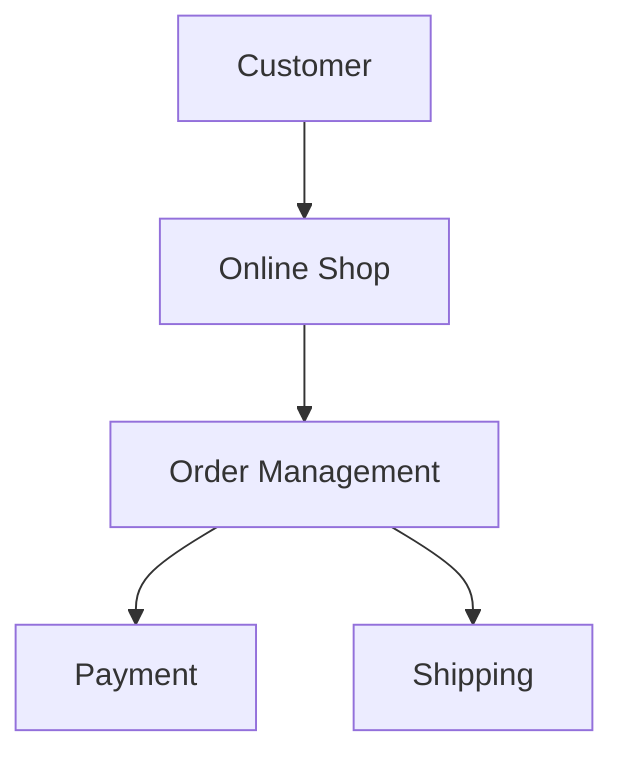
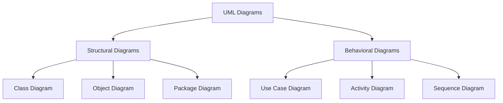
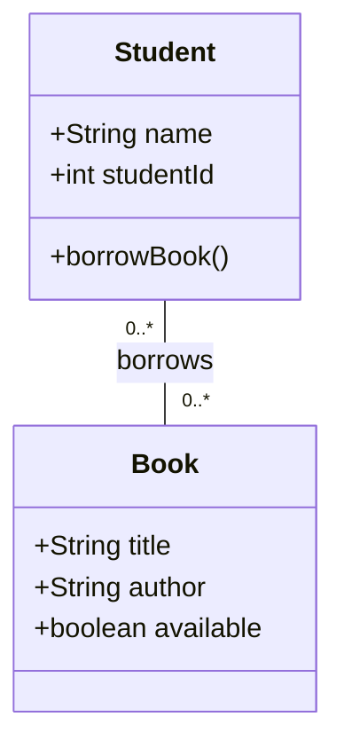

# 01 — Introduction to UML

## 1. What Is UML?

**UML (Unified Modeling Language)** is a visual language used to describe, design, and understand software systems.

Instead of explaining a software system using only text or code, UML allows us to represent it using diagrams.

Think of UML as a **blueprint for software**.

Before building a house, architects often create drawings to show rooms, doors, and connections.

Software developers can do something similar with UML.

They can draw diagrams to show:

- What parts a system contains.
- How those parts are connected.
- How users interact with the system.
- How information moves through the system.

**Important:** UML is not a programming language. It helps us model and communicate software designs.

---

## 2. Why Do We Need UML?

Imagine you are developing an online shopping application.

The application needs to:

1. Allow customers to browse products.
2. Let customers place orders.
3. Process payments.
4. Arrange product delivery.

You could start writing code immediately.

But what happens if the application becomes large?

It might become difficult to understand which components are responsible for each task and how they interact.

**UML helps us understand the design before and during development.**

For example, we can describe a simple shopping system using this diagram:



This diagram gives us a simple overview of the system.

We can quickly understand that:

- The customer interacts with the online shop.
- The shop uses order management.
- Order management works with payment and shipping.

This is a **conceptual overview drawn with Mermaid**, not a formal UML diagram. We will learn formal UML notation in later lessons.

---

## 3. Main Types of UML Diagrams

UML diagrams are divided into two main categories.

### A. Structural Diagrams

Structural diagrams describe **what a system contains and how its parts are organized**.

For example:

- Class Diagram
- Object Diagram
- Package Diagram
- Composite Structure Diagram
- Component Diagram
- Deployment Diagram

Think of structural diagrams as pictures of a system's organization.

### B. Behavioral Diagrams

Behavioral diagrams describe **what a system does and how it behaves**.

For example:

- Use Case Diagram
- Activity Diagram
- State Machine Diagram
- Sequence Diagram
- Communication Diagram

Sequence diagrams belong to the UML interaction-diagram family, which is part of behavioral diagrams.

### Visual Overview



This is a simplified overview showing some commonly used UML diagrams, not the complete UML diagram catalog.

---

## 4. A Simple UML Class Diagram

Let's imagine that we want to model a library.

A library contains books, and students can borrow books.

First, we identify two classes:

**Student**
- Has a name.
- Has a student ID.
- Can borrow a book.

**Book**
- Has a title.
- Has an author.
- Can be borrowed.

We can represent these classes with a UML Class Diagram.



### How to Read This Diagram

Each rectangle represents a **class**.

A class describes a type of object in our software.

For example, the `Student` class describes the information and behavior of students.

Inside the class, we can see:

- **Attributes:** information stored by an object, such as `name`.
- **Operations:** actions an object can perform, such as `borrowBook()`.

The line between `Student` and `Book` represents an **Association**.

An Association describes a relationship between classes.

The numbers `0..*` mean zero or many.

In this example:

- A student can be related to many books.
- A book can be related to many students, such as across different borrowing periods.

This is a simplified model. A real library system would usually include a separate `Loan` class to track borrowing dates, returns, and active loans.

We will explore classes, associations, and multiplicity in detail in later lessons.

---

## 5. Connecting UML to Python

Let's implement a simplified version of our example in Python.

```python
class Book:
    def __init__(self, title, author):
        self.title = title
        self.author = author
        self.available = True


class Student:
    def __init__(self, name, student_id):
        self.name = name
        self.student_id = student_id
        self.borrowed_books = []

    def borrow_book(self, book):
        if book.available:
            self.borrowed_books.append(book)
            book.available = False
            print(f"{self.name} borrowed {book.title}")
        else:
            print("This book is not available.")


book = Book("Clean Code", "Robert C. Martin")
student = Student("Alice", 101)

student.borrow_book(book)
```

Output:

```text
Alice borrowed Clean Code
```

### What Happened?

We defined two classes:

- `Book`
- `Student`

Then we created two objects:

- `book` is an object of the `Book` class.
- `student` is an object of the `Student` class.

When Alice borrows a book:

1. The program checks whether the book is available.
2. The book is added to Alice's borrowed books.
3. The book becomes unavailable.

This implementation is intentionally simple and models one active borrowing at a time. A complete library application would need additional rules and a borrowing history.

**The main idea:** UML helps us understand the structure of the system, while Python allows us to implement its behavior.

---

## 6. When Should We Use UML?

UML is useful when:

- Planning a new software application.
- Understanding an existing codebase.
- Designing relationships between classes.
- Explaining architecture to other developers.
- Documenting complex systems.
- Discussing system behavior before implementation.

You do not need to create every UML diagram for every project.

Choose the diagrams that help you understand or communicate your design.

---

## 7. Common Beginner Mistakes

### Mistake 1: Thinking UML Is a Programming Language

UML does not execute code.

It describes software structures and behaviors through diagrams.

### Mistake 2: Thinking UML Is Only for Large Projects

Even a small application can benefit from a simple class or sequence diagram.

### Mistake 3: Thinking Every Diagram Is a UML Diagram

A flowchart can help explain software, but not every flowchart follows UML notation.

### Mistake 4: Making Diagrams Too Complicated

A diagram should make the system easier to understand.

Start with the important parts and add details only when necessary.

---

## 8. Quick Practice

**Question 1**

What does UML stand for?

**Question 2**

What is the main difference between structural and behavioral diagrams?

**Question 3**

Which UML diagram would you use to show classes and their relationships?

**Question 4**

Is UML a programming language? Why or why not?

**Question 5**

Imagine you are developing a food delivery application.

Name three classes you might include in its class diagram.

<details>
<summary>Show Answers</summary>

1. Unified Modeling Language.
2. Structural diagrams describe how a system is organized. Behavioral diagrams describe what it does and how it behaves.
3. Class Diagram.
4. No. UML is a visual modeling language, not an executable programming language.
5. Possible answers: Customer, Restaurant, Order, DeliveryDriver, and Payment.

</details>

---

## 9. Key Takeaways

- UML stands for Unified Modeling Language.
- UML is used to model, visualize, and document software systems.
- Structural diagrams show how a system is organized.
- Behavioral diagrams show how a system behaves.
- Class diagrams describe classes and their relationships.
- UML is not a replacement for programming.
- Good diagrams should be simple, clear, and useful.

---

**Next Lesson:** [Classes vs. Objects](./class-vs-object.md) *(coming soon)*

In the next lesson, we will explore the difference between a class and an object using simple Python examples and UML diagrams.