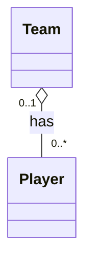
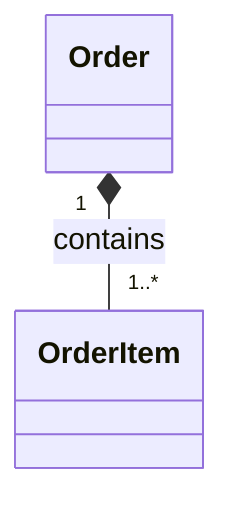
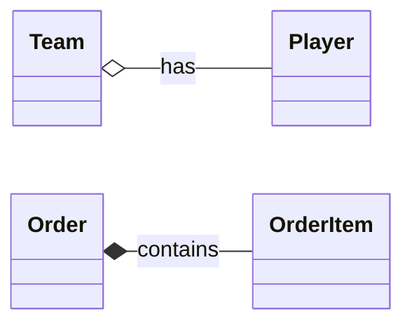
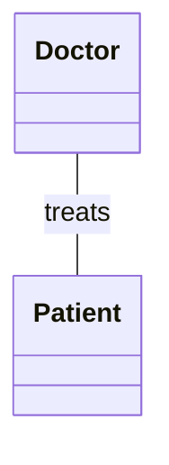
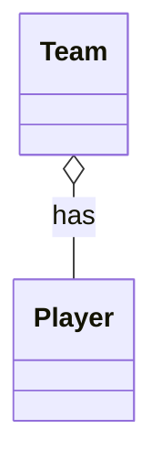
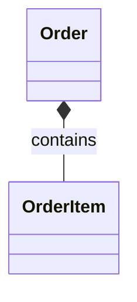
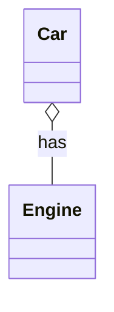
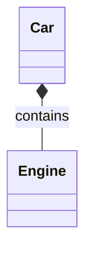

# 06 — Aggregation and Composition in UML

## 1. What Are Aggregation and Composition?

In the previous lesson, we learned about **Association**, a relationship that connects classes.

Now imagine two situations:

**Situation A:** A football team has players.

**Situation B:** An online order contains order items.

Both situations describe something made up of smaller parts.

But there is an important difference.

If a football team is dissolved, its players still exist.

If an order is deleted, its order items usually have no reason to exist independently.

UML uses two special types of Association to describe these relationships:

- **Aggregation:** A weak whole-part relationship.
- **Composition:** A strong whole-part relationship with lifecycle ownership.

Both represent a **HAS-A relationship**, but they communicate different levels of ownership.

---

## 2. What Is Aggregation?

**Aggregation** represents a whole-part relationship where the parts can exist independently of the whole.

Let's use a football team.

A team contains players.

However:

- Players can exist before joining the team.
- Players can leave the team.
- Players can join another team.
- Players still exist if the team is dissolved.

This makes Aggregation a possible way to model the relationship.

### UML Diagram



### How to Read the Diagram

The **hollow diamond (`◇`)** represents Aggregation.

The diamond is placed next to the whole.

In this example:

- `Team` is the whole.
- `Player` is the part.
- One team can have zero or many players.
- In this simplified model, one player belongs to zero or one team at a time.

The important idea is that a player can exist without a team.

### A Real-World Example

Imagine:

- Team A has Alice and Bob.
- Team B has Sara and John.

Now Team A is dissolved.

Alice and Bob do not disappear.

They can join Team B or another team.

Their existence does not depend on Team A.

---

## 3. Aggregation in Python

Let's implement the previous example.

```python
class Player:
    def __init__(self, name):
        self.name = name


class Team:
    def __init__(self, name):
        self.name = name
        self.players = []

    def add_player(self, player):
        self.players.append(player)


alice = Player("Alice")
bob = Player("Bob")

team = Team("Tigers")

team.add_player(alice)
team.add_player(bob)

print([player.name for player in team.players])

del team

print(alice.name)
print(bob.name)
```

Output:

```text
['Alice', 'Bob']
Alice
Bob
```

### What Happened?

We created the players independently of the team.

Then we added them to the team.

When we deleted the `team` variable, the players were still accessible.

This demonstrates the idea behind Aggregation:

**The parts can exist independently of the whole.**

Note that Python does not automatically enforce UML Aggregation rules. The code is a simple illustration of the concept.

Also, UML shared Aggregation has relatively weak formal semantics. A hollow diamond does not automatically enforce ownership, exclusive membership, or deletion behavior.

---

## 4. What Is Composition?

**Composition** is a stronger form of whole-part relationship.

In Composition, the parts belong to a specific whole and have a lifecycle that depends on that whole.

Let's imagine an online shopping system.

An order contains order items.

For example:

**Order #101**

- 2 laptops
- 1 mouse
- 3 keyboards

Each row is an `OrderItem`.

The `OrderItem` is not the actual product.

It is a record describing a particular product and quantity within a particular order.

If Order #101 is deleted, its order items would normally be deleted as well.

This is a good example of Composition.

### UML Diagram



### How to Read the Diagram

The **filled diamond (`◆`)** represents Composition.

The diamond is placed next to the whole.

Here:

- `Order` is the whole.
- `OrderItem` is the part.
- An order contains one or more order items.
- Each order item belongs to exactly one order in this model.

The main idea is:

**An OrderItem has no independent lifecycle outside its owning Order.**

---

## 5. Composition and Object Lifecycle

Let's understand what lifecycle means.

Imagine an order with three items:

```text
Order #101
├── OrderItem 1: Laptop, quantity 2
├── OrderItem 2: Mouse, quantity 1
└── OrderItem 3: Keyboard, quantity 3
```

These order items exist because Order #101 exists.

If the order is permanently removed, its order items should no longer exist as parts of that order.

In UML Composition, a part can belong to at most one composite whole at a time.

However, Composition does not mean that a part can never be moved from one whole to another.

It may be transferred if the system's rules allow it.

Also, lifecycle ownership does not necessarily mean that database records must be physically deleted immediately.

Those details depend on the implementation.

---

## 6. Composition in Python

Let's implement the order example.

```python
class OrderItem:
    def __init__(self, product, quantity, price):
        self.product = product
        self.quantity = quantity
        self.price = price

    def get_total(self):
        return self.quantity * self.price


class Order:
    def __init__(self, order_id):
        self.order_id = order_id
        self.items = []

    def add_item(self, product, quantity, price):
        item = OrderItem(product, quantity, price)
        self.items.append(item)

    def calculate_total(self):
        return sum(item.get_total() for item in self.items)


order = Order(101)

order.add_item("Laptop", 2, 1000)
order.add_item("Mouse", 1, 50)

print(order.calculate_total())
```

Output:

```text
2050
```

### What Happened?

The `Order` class creates and manages its own `OrderItem` objects.

Each order item represents a part of a specific order.

This is a simple Composition-style design.

**Important:** Python does not automatically enforce UML Composition semantics.

For example, if another variable keeps a reference to an `OrderItem`, that object can remain in memory after the order is deleted.

The application must enforce ownership and lifecycle rules where necessary.

---

## 7. Aggregation vs. Composition

Let's compare both relationships.

| Feature | Aggregation | Composition |
|---|---|---|
| Relationship | Weak whole-part | Strong whole-part |
| UML symbol | Hollow diamond `◇` | Filled diamond `◆` |
| Diamond location | Next to the whole | Next to the whole |
| Part independence | Parts can exist independently | Parts have a dependent lifecycle |
| Exclusive ownership | Not required | At most one composite owner at a time |
| Example | Team and Player | Order and OrderItem |

### Visual Comparison



Notice the difference between the diamonds.

- `o--` creates a hollow diamond in Mermaid.
- `*--` creates a filled diamond in Mermaid.

Both diamonds are placed at the whole end of the relationship.

### A Simple Rule

Ask yourself:

**Can the part exist independently of the whole?**

If yes, Aggregation might be appropriate.

If the part's lifecycle belongs to the whole, Composition might be appropriate.

But remember that this is a helpful starting point, not a complete rule for every design.

---

## 8. Association vs. Aggregation vs. Composition

Now let's compare three relationships.

### Association

A doctor treats a patient.



The doctor and patient are connected.

But neither is a part of the other.

This is a normal Association.

### Aggregation

A team has players.



Players are members of a whole, but they exist independently.

### Composition

An order contains order items.



Order items have a lifecycle tied to their order.

### Summary

| Relationship | Main Question |
|---|---|
| Association | Are these objects connected? |
| Aggregation | Does one represent a whole with independent parts? |
| Composition | Does one whole control the parts' lifecycle? |

Aggregation and Composition are both special forms of Association.

---

## 9. A Tricky Example: Car and Engine

Imagine a car that has an engine.

At first, we might say:

`Car HAS-A Engine`

But should we use Aggregation or Composition?

The answer depends on the model.

### Situation A: Independent Engines

Suppose engines are manufactured separately.

They can be:

- Stored in a warehouse.
- Installed in a car.
- Removed from a car.
- Installed in another car.

If our system manages engines independently, Aggregation or ordinary Association may be more suitable.



### Situation B: Engine as a Lifecycle-Dependent Part

Imagine a simplified simulation where each car owns an engine object that cannot exist independently of the car.

In this model, Composition may be appropriate.



### Important Lesson

**The same real-world objects can be modeled differently depending on the requirements of the software.**

UML is about representing the rules of your system, not just copying the physical world.

---

## 10. Aggregation and Composition with Multiplicity

Aggregation and Composition can have multiplicity values, just like normal Association.

### Aggregation Example


This means:

- Each team can have zero or many players.
- Each player can belong to zero or one team in this particular model.

### Composition Example


This means:

- An order must contain at least one order item.
- Each order item belongs to exactly one order.

Remember:

**Multiplicity describes how many objects can be connected.**

**Aggregation and Composition describe the nature of the whole-part relationship.**

These are separate concepts.

---

## 11. Common Beginner Mistakes

### Mistake 1: Thinking HAS-A Always Means Composition

Not every HAS-A relationship is Composition.

For example:

- A team has players.
- A car has an engine.
- An order has order items.

These relationships may have different lifecycle and ownership rules.

### Mistake 2: Placing the Diamond Next to the Part

The diamond belongs next to the **whole**, not the part.

### Mistake 3: Thinking Composition Means Immediate Database Deletion

Composition describes lifecycle ownership at the modeling level.

Database deletion policies are implementation details.

### Mistake 4: Assuming Python Automatically Enforces Composition

Python references do not automatically enforce UML ownership rules.

Those rules must be reflected in the program's design.

### Mistake 5: Using Aggregation Everywhere

A hollow diamond is not required for every relationship that sounds like "has a."

If the whole-part meaning is unclear, a normal Association is often sufficient.

### Mistake 6: Confusing Composition with Inheritance

These are very different relationships.

- Inheritance: `Car IS-A Vehicle`
- Composition: `Order HAS-A OrderItem`

Inheritance describes a type relationship.

Composition describes a whole-part relationship.

---

## 12. Quick Practice

### Question 1

What is the main difference between Aggregation and Composition?

### Question 2

Which UML symbol represents Composition?

### Question 3

A football team has players.

If the team is dissolved, the players still exist.

Which relationship might be appropriate?

### Question 4

An online order has order items.

The order items should not exist independently of the order.

Which relationship is more suitable?

### Question 5

Where should the diamond appear in a whole-part relationship?

### Question 6

Can the same two real-world concepts use Aggregation in one system and Composition in another?

Explain why.

<details>
<summary>Show Answers</summary>

1. Aggregation represents a weak whole-part relationship, while Composition represents stronger ownership and dependent lifecycle.
2. A filled diamond (`◆`).
3. Aggregation, assuming the model treats players as members of the team.
4. Composition.
5. Next to the whole.
6. Yes. Different software systems may define different ownership and lifecycle rules for the same real-world concepts.

</details>

---

## 13. Key Takeaways

- Aggregation and Composition are special forms of Association.
- Both describe whole-part relationships.
- Aggregation uses a hollow diamond.
- Composition uses a filled diamond.
- The diamond is always placed next to the whole.
- Aggregated parts can exist independently.
- Composed parts have lifecycles controlled by their composite whole.
- A composed part can belong to at most one composite whole at a time.
- Multiplicity can be used with both relationships.
- The correct relationship depends on the software model and its requirements.

---

**Next Lesson:** Multiplicity and Navigability — Reading Relationship Details in UML.

We will practice understanding multiplicity values, navigation directions, and common mistakes when reading relationships between classes.