# 05 — Association in UML

## 1. What Is Association?

An **Association** is a relationship between two classes.

It shows that objects of one class can be connected to objects of another class.

Let's imagine a university system.

We have two classes:

- `Student`
- `University`

A student studies at a university.

But is a student a type of university?

No!

`Student IS-A University` ❌

Instead, a student **is associated with** a university.

This relationship is called Association.

### UML Example

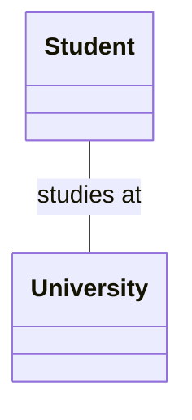

The solid line between `Student` and `University` represents an Association.

**Important:** Association describes a relationship, not inheritance.

---

## 2. Association vs. Generalization

In the previous lesson, we learned about Generalization.

Let's compare the two relationships.

### Generalization

A dog is an animal.

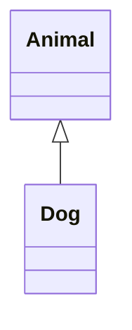

This is an **IS-A** relationship.

### Association

A student studies at a university.


This is a relationship between two different classes.

### Key Difference

| Generalization | Association |
|---|---|
| Represents IS-A | Represents a connection |
| Uses a hollow triangle | Uses a solid line |
| Supports inheritance | Does not imply inheritance |
| Dog is an Animal | Student studies at University |

A simple way to remember:

**Generalization = What type of thing is it?**

**Association = What is it connected to?**

---

## 3. Understanding Multiplicity

This is one of the most important concepts in Association.

**Multiplicity tells us how many objects can participate in a relationship.**

Imagine an online shopping system.

A customer can place multiple orders.

But each order belongs to exactly one customer.

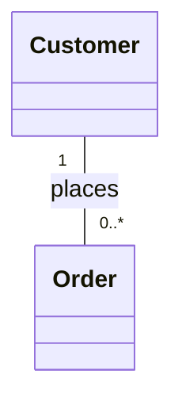

Let's read the diagram carefully.

### What Does `1` Mean?

The number `1` appears next to `Customer`.

It means:

**Each Order is associated with exactly one Customer.**

### What Does `0..*` Mean?

The value `0..*` appears next to `Order`.

It means:

**Each Customer can have zero or many Orders.**

For example:

- Alice has 3 orders.
- Bob has 1 order.
- Sara has 0 orders.

All three cases are valid.

### Common Multiplicity Values

| Symbol | Meaning | Example |
|---|---|---|
| `1` | Exactly one | An order has one customer |
| `0..1` | Zero or one | An employee may have one parking space |
| `0..*` | Zero or many | A customer may have many orders |
| `1..*` | One or more | An order must contain at least one item |
| `2..5` | Between two and five | A team may require 2 to 5 members |
| `*` | Zero or many | Another way to write `0..*` |

### Important Rule

**The multiplicity written next to a class describes how many objects of that class can be connected to one object at the opposite end.**

This is easy to confuse.

Always read the number from the opposite class.

---

## 4. Types of Association Based on Multiplicity

We often describe associations using three common patterns.

### A. One-to-One

Imagine a system where every user has exactly one profile, and every profile belongs to exactly one user.

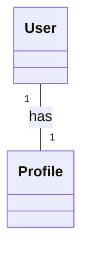

This is a one-to-one relationship.

One `User` is connected to one `Profile`.

And one `Profile` is connected to one `User`.

### B. One-to-Many

Imagine a customer placing orders.


One customer can have many orders.

Each order belongs to one customer.

This is a one-to-many relationship.

### C. Many-to-Many

Imagine students enrolling in university courses.

A student can enroll in multiple courses.

A course can contain multiple students.

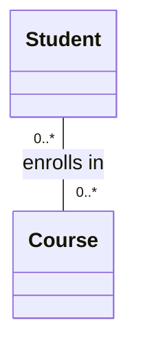

For example:

| Student | Courses |
|---|---|
| Alice | Math, Physics |
| Bob | Math, English |
| Sara | Physics, English |

The relationship is many-to-many because both sides can be connected to multiple objects.

**Note:** Multiplicity rules depend on the requirements of the system. The values in these examples are design assumptions, not universal rules.

---

## 5. Association in Python

Let's implement the customer and order example.

### UML Diagram

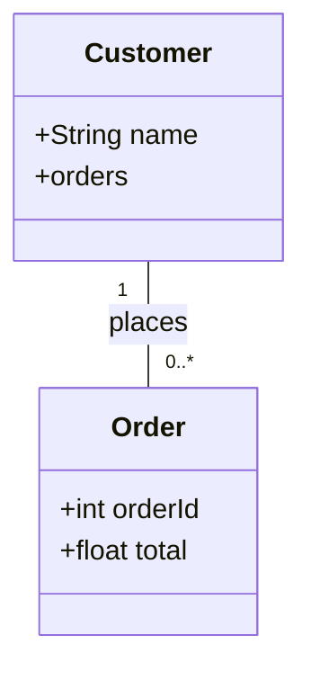

### Python Implementation

```python
class Customer:
    def __init__(self, name):
        self.name = name
        self.orders = []


class Order:
    def __init__(self, order_id, total, customer):
        self.order_id = order_id
        self.total = total
        self.customer = customer

        customer.orders.append(self)


alice = Customer("Alice")

order1 = Order(101, 50.0, alice)
order2 = Order(102, 120.0, alice)

print(len(alice.orders))
print(order1.customer.name)
```

Output:

```text
2
Alice
```

### What Happened?

We created:

- One Customer object: `alice`
- Two Order objects: `order1` and `order2`

Both orders belong to Alice.

We can access Alice's orders:

```python
print(alice.orders)
```

We can also access the customer of an order:

```python
print(order1.customer.name)
```

This implementation demonstrates an Association between two classes.

Notice that `Order` does not inherit from `Customer`.

The classes simply hold references to related objects.

---

## 6. What Is Navigability?

**Navigability describes whether we can navigate from an object at one end of an Association to related objects at the other end.**

Let's use the same example:

- Customer
- Order

We want to answer two questions:

1. Can a customer find their orders?
2. Can an order find its customer?

The answer depends on how we design the relationship.

### A. One-Way Navigability

Suppose a customer can access their orders.

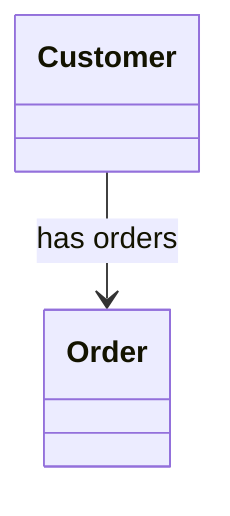

The navigation arrow points toward `Order`.

This means that the relationship is navigable from `Customer` to `Order`.

For example:

```python
customer.orders
```

But navigation in the other direction is not defined in this example.

An `Order` does not necessarily have a direct reference to its `Customer`.

### B. Reverse Navigability

Now imagine that an order can access its customer.

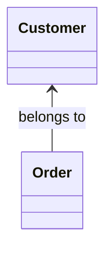

Here, navigation goes from `Order` to `Customer`.

For example:

```python
order.customer
```

The customer does not necessarily have a direct reference to the order.

### C. Two-Way Navigability

Sometimes both objects need to access each other.

For example:

```python
customer.orders
order.customer
```

This is called **Bidirectional Navigability**.

We can represent the idea with navigation arrows at both ends:

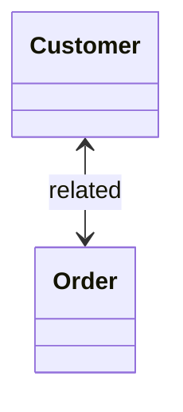

The code from Section 5 demonstrates this type of access.

### An Important UML Detail

An Association without arrows does not always mean that navigation is bidirectional.

Depending on the UML notation and modeling conventions, navigability may simply be unspecified.

Also, navigability does not describe HTTP requests or network traffic.

It describes the ability to navigate a relationship between objects in the model.

---

## 7. What Are Role Names?

A **Role Name** describes the role an object plays at one end of an Association.

Let's imagine a company system.

We have:

- `Employee`
- `Department`

Each employee works in a department.

And each department contains employees.

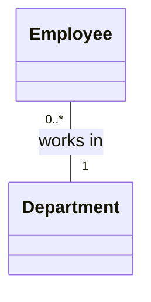

We can describe the association ends using these role names:

| Class | Role Name | Meaning |
|---|---|---|
| Employee | `employees` | Employees working in a department |
| Department | `department` | Department of an employee |

For example, in Python:

```python
employee.department
department.employees
```

These names explain how the objects are related.

### Why Are Role Names Useful?

They make relationships easier to understand, especially when the same two classes have multiple associations.

For example, a `Person` might be related to another `Person` as a manager, friend, or family member.

Role names help distinguish these relationships.

---

## 8. Self-Association (Reflexive Association)

An Association does not always connect two different classes.

Sometimes a class can be associated with itself.

This is called a **Self-Association** or **Reflexive Association**.

### Real-World Example: Employees and Managers

Imagine a company.

An employee can have a manager.

But a manager is also an employee.

We do not need a completely separate `Manager` class for this simple model.

Instead, we can use a self-association.

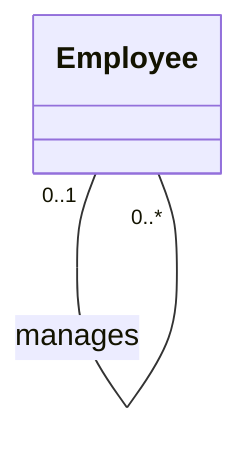

In this example:

- Each employee may have zero or one manager.
- Each manager may manage zero or many employees.

The `Employee` class is associated with itself.

### Python Example

```python
class Employee:
    def __init__(self, name, manager=None):
        self.name = name
        self.manager = manager
        self.subordinates = []


manager = Employee("Alice")

bob = Employee("Bob", manager)
sara = Employee("Sara", manager)

manager.subordinates.append(bob)
manager.subordinates.append(sara)

print(bob.manager.name)
print(len(manager.subordinates))
```

Output:

```text
Alice
2
```

This represents employees connected to other employees through a management relationship.

---

## 9. Association vs. Link

You may remember the term **Link** from Object Diagrams.

Let's understand the difference.

### Association

An Association describes a relationship between classes.


It tells us that Customer and Order objects can be related.

### Link

A Link represents a specific connection between objects.

For example:

- Alice has order 101.
- Alice also has order 102.

A simplified visualization:

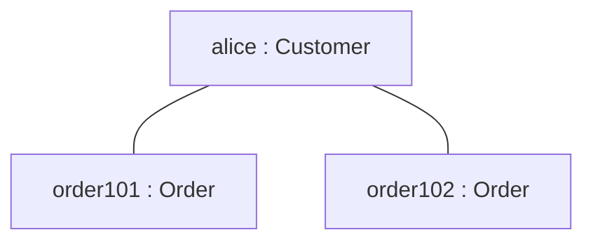

There are two Links:

1. `alice` connected to `order101`
2. `alice` connected to `order102`

This Mermaid flowchart is a simplified object-level illustration, not a formal UML Object Diagram.

### Remember

**Association = Relationship between classes**

**Link = Connection between specific objects**

---

## 10. Association vs. Dependency

Association and Dependency are different UML relationships.

An Association describes a structural relationship between classifiers.

A Dependency means that one element relies on another in some way.

### Association Example

An `Order` stores a reference to its `Customer`.

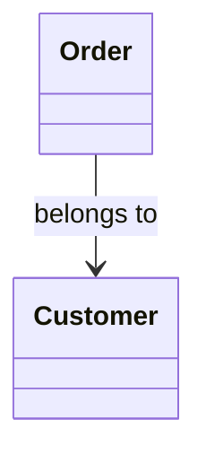

This describes a navigable structural relationship.

### Dependency Example

An order-processing service uses a notification service to send a message.

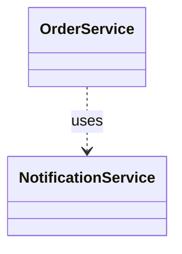

This is a Dependency.

The dashed arrow points toward the element being used.

### Main Difference

| Association | Dependency |
|---|---|
| Structural relationship | Usage or reliance |
| Usually shown with a solid line | Shown with a dashed arrow |
| Can have multiplicity | Does not use Association-end multiplicity |
| Example: Order has a Customer | Example: OrderService uses NotificationService |

---

## 11. Common Beginner Mistakes

### Mistake 1: Confusing Association with Inheritance

Incorrect:

`Student IS-A University`

A student is not a university.

The correct relationship is usually an Association.

### Mistake 2: Reading Multiplicity from the Wrong Side

Consider:

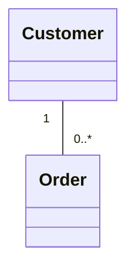

The `0..*` next to `Order` describes how many orders one customer can have.

The `1` next to `Customer` describes how many customers one order can have.

### Mistake 3: Thinking Every Association Is Bidirectional

Navigability may be one-way, two-way, or unspecified.

Do not assume that every relationship allows navigation in both directions.

### Mistake 4: Confusing Navigability with Multiplicity

Multiplicity answers:

**How many related objects are allowed?**

Navigability answers:

**In which direction can we navigate the relationship?**

They describe different things.

### Mistake 5: Thinking Every Association Requires Inheritance

Association does not require a parent-child class relationship.

For example, `Customer` and `Order` can be associated without either class inheriting from the other.

---

## 12. Quick Practice

### Question 1

What is an Association in UML?

### Question 2

Consider:

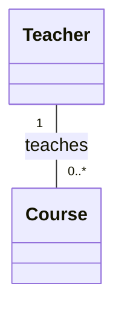

How many teachers can be associated with one course?

How many courses can one teacher teach?

### Question 3

What does `0..1` mean?

### Question 4

What is the difference between Navigability and Multiplicity?

### Question 5

A student can enroll in multiple courses, and each course can have multiple students.

Is this one-to-one, one-to-many, or many-to-many?

### Question 6

What is a Self-Association? Give an example.

<details>
<summary>Show Answers</summary>

1. An Association is a structural relationship between classes that allows their objects to be connected.
2. Each course has exactly one teacher, and each teacher can teach zero or many courses, according to this model.
3. Zero or one related object.
4. Multiplicity describes the number of related objects; Navigability describes the direction in which related objects can be accessed.
5. Many-to-many.
6. A relationship between a class and itself. For example, an Employee may manage other Employees.

</details>

---

## 13. Key Takeaways

- Association describes a relationship between classes.
- It does not imply inheritance.
- A solid line represents an Association in UML.
- Multiplicity describes how many objects can be related.
- One-to-one, one-to-many, and many-to-many are common multiplicity patterns.
- Navigability describes the direction of access between related objects.
- Role names describe the roles played at association ends.
- Self-Association connects a class to itself.
- Association describes a relationship at the class level.
- A Link represents a specific connection between objects.

---

**Next Lesson:** Aggregation and Composition — Understanding Whole-Part Relationships.

We will explore how classes can represent parts of a larger whole, why some parts can exist independently, and how to distinguish Aggregation from Composition.