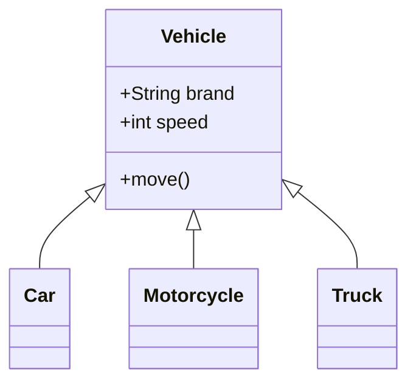
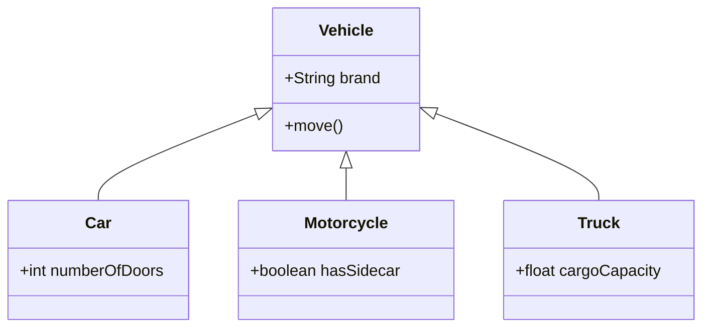
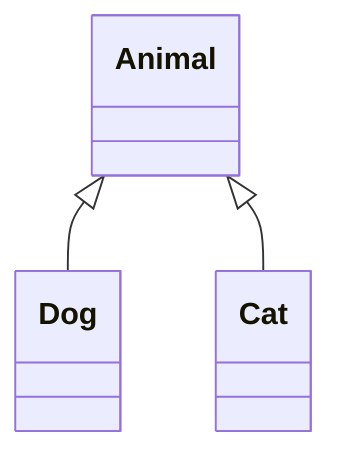
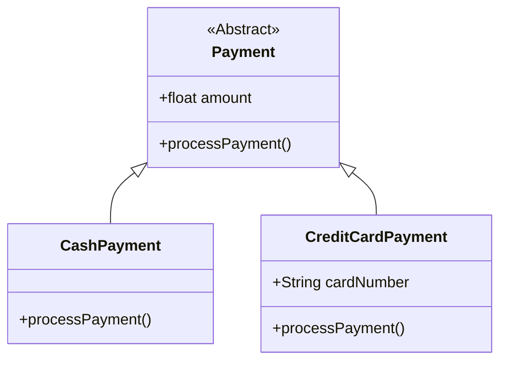
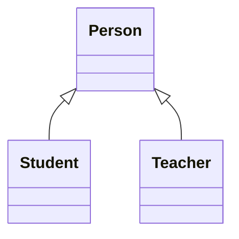

# 04 — Generalization and Specialization in UML

## 1. What Are Generalization and Specialization?

**Generalization and Specialization** describe a relationship between a general class and more specific classes.

Let's imagine a system that manages different types of vehicles.

We have:

- `Car`
- `Motorcycle`
- `Truck`

All three are types of vehicles.

They share common characteristics:

- A brand
- A speed
- The ability to move

Instead of defining these characteristics separately in every class, we can create a general class called `Vehicle`.



In this diagram:

- `Vehicle` is the **parent class** (Superclass).
- `Car`, `Motorcycle`, and `Truck` are **child classes** (Subclasses).

The child classes inherit inheritable attributes and operations from the parent class.

**Important:** Generalization and Specialization describe the same type of relationship, but from different directions.

---

## 2. What Is Generalization?

**Generalization** means identifying common characteristics of specific classes and creating a more general class.

Imagine we already have these classes:

- `Car`
- `Motorcycle`
- `Truck`

We notice that they all have a brand, speed, and movement behavior.

We can move their common characteristics into a new class: `Vehicle`.

This process is called Generalization.

Think of it as moving **from specific to general**.

For example:

`Car, Motorcycle, Truck → Vehicle`

### Why Is This Useful?

Without Generalization, we might repeat the same attributes and operations across several classes.

Generalization helps us:

- Organize related classes.
- Share common behavior.
- Reduce unnecessary code duplication.
- Make class relationships easier to understand.

However, reducing duplicate code alone is not a good reason to introduce inheritance. The classes must also have a meaningful type relationship.

---

## 3. What Is Specialization?

**Specialization** is the opposite way of looking at the same relationship.

We start with a general class and create more specific classes.

For example, we already have:

`Vehicle`

Now we want to describe different types of vehicles:

- `Car`
- `Motorcycle`
- `Truck`

Each specialized class can have its own attributes and behavior.

For example:

- A car might have a number of doors.
- A motorcycle might have a sidecar option.
- A truck might have a maximum cargo capacity.



Here, we are moving **from general to specific**.

### Generalization vs. Specialization

| Generalization | Specialization |
|---|---|
| Specific → General | General → Specific |
| Finds shared characteristics | Defines specific characteristics |
| Car and Truck → Vehicle | Vehicle → Car and Truck |
| Builds a general abstraction | Creates specialized types |

Both lead to a class hierarchy.

---

## 4. Understanding the IS-A Relationship

This is the most important rule for understanding Generalization.

A valid generalization should represent an **IS-A relationship**.

IS-A means:

**One class represents a more specific type of another class.**

For example:

- A `Car` **is a** `Vehicle`. ✅
- A `Motorcycle` **is a** `Vehicle`. ✅
- A `Dog` **is an** `Animal`. ✅

Now consider:

- An `Engine` **is a** `Car`. ❌
- A `Student` **is a** `University`. ❌

These are incorrect because an engine is not a type of car, and a student is not a type of university.

### A Simple Test

Before using Generalization, ask:

**"Is every instance of the child class also an instance of the parent class?"**

If the answer is yes, Generalization might be appropriate.

But remember: IS-A is a necessary starting point, not the only requirement. The child class must also behave consistently with the parent class.

---

## 5. UML Notation for Generalization

Generalization is represented by:

**A solid line with a hollow triangle pointing toward the parent class.**



In this diagram:

- `Animal` is the parent class.
- `Dog` and `Cat` are child classes.
- The hollow triangle points to `Animal`.

### Common Mistake

Do not confuse the inheritance triangle with an Association arrow.

The hollow triangle represents a type hierarchy, not normal communication between classes.

---

## 6. Generalization in Python

Let's implement the vehicle example.

```python
class Vehicle:
    def __init__(self, brand):
        self.brand = brand

    def move(self):
        print(f"{self.brand} is moving.")


class Car(Vehicle):
    def open_trunk(self):
        print("Opening the trunk.")


class Motorcycle(Vehicle):
    def wheelie(self):
        print("Performing a wheelie.")


car = Car("Toyota")
motorcycle = Motorcycle("Honda")

car.move()
car.open_trunk()

motorcycle.move()
motorcycle.wheelie()
```

Output:

```text
Toyota is moving.
Opening the trunk.
Honda is moving.
Performing a wheelie.
```

### What Happened?

The `Vehicle` class defines the common attribute `brand` and operation `move()`.

The `Car` and `Motorcycle` classes inherit from `Vehicle`.

They can use `move()` without implementing it again.

They also define their own specific operations.

This is an example of inheritance in object-oriented programming.

---

## 7. What Is an Abstract Class?

Sometimes we create a general class only to provide a common structure for other classes.

We do not want to create objects directly from that class.

Such a class can be an **Abstract Class**.

For example, imagine a payment system with these payment methods:

- Cash payment
- Credit card payment

Every payment has an amount, but the payment process is different.

We can define an abstract class called `Payment`.

### UML Diagram



In UML, abstract classes and operations can be shown in italics or marked with an abstract constraint. Here, Mermaid uses an `<<Abstract>>` annotation to communicate the idea.

### Python Implementation

```python
from abc import ABC, abstractmethod


class Payment(ABC):
    def __init__(self, amount):
        self.amount = amount

    @abstractmethod
    def process_payment(self):
        pass


class CashPayment(Payment):
    def process_payment(self):
        print(f"Paid {self.amount} in cash.")


class CreditCardPayment(Payment):
    def __init__(self, amount, card_number):
        super().__init__(amount)
        self.card_number = card_number

    def process_payment(self):
        print(f"Paid {self.amount} using a credit card.")


cash = CashPayment(100)
card = CreditCardPayment(200, "1234")

cash.process_payment()
card.process_payment()
```

Output:

```text
Paid 100 in cash.
Paid 200 using a credit card.
```

### Why Use an Abstract Class?

An abstract class allows us to define a shared contract for related classes.

Every concrete payment type must implement `process_payment()` before it can be instantiated.

For example:

```python
payment = Payment(100)
```

This raises a `TypeError` because `Payment` is abstract.

**Important:** A parent class does not have to be abstract. Many valid inheritance relationships use concrete parent classes.

---

## 8. Inheritance vs. Code Reuse

Inheritance can help us reuse code.

However, **code reuse alone does not make inheritance a good design choice**.

Consider this example:

```python
class Printer:
    def print_document(self):
        print("Printing document")


class Student(Printer):
    pass
```

The code works in Python.

But does this relationship make sense?

`Student IS-A Printer` ❌

No.

A student is not a type of printer.

We only used inheritance to reuse the `print_document()` method.

This is a poor use of inheritance.

### A Better Design

A student can use a printer instead of inheriting from it.

```python
class Printer:
    def print_document(self):
        print("Printing document")


class Student:
    def __init__(self, printer):
        self.printer = printer

    def print_assignment(self):
        self.printer.print_document()


printer = Printer()
student = Student(printer)

student.print_assignment()
```

Now the relationship is more meaningful:

`Student HAS-A Printer reference`

The student uses a printer without becoming a specialized printer.

This is an example of using object composition instead of inheritance.

---

## 9. A Tricky Example: Square and Rectangle

Mathematically, a square is a rectangle.

So we might think:

`Square IS-A Rectangle` ✅

But software design also depends on behavior.

Imagine that our `Rectangle` class allows us to change width and height independently.

```python
class Rectangle:
    def __init__(self, width, height):
        self.width = width
        self.height = height

    def set_width(self, width):
        self.width = width

    def set_height(self, height):
        self.height = height
```

Now imagine `Square` inherits from `Rectangle`.

A square must always have equal width and height.

What happens if we call:

```python
square.set_width(20)
```

There are two possibilities:

1. Only the width changes, and the object is no longer a valid square.
2. Both width and height change, which is different from the expected behavior of `Rectangle`.

This creates a design problem.

### The Liskov Substitution Principle (LSP)

LSP says that an object of a subtype should be usable wherever an object of its parent type is expected, without breaking the parent's behavioral contract.

If code expects rectangle width and height to change independently, a mutable square cannot safely replace it.

**Lesson:** An IS-A relationship in the real world does not automatically guarantee safe inheritance in software.

With a different design, such as immutable shapes, this inheritance relationship may be acceptable.

---

## 10. Another Tricky Example: Electric Cars

An electric car is clearly a vehicle.

`ElectricCar IS-A Vehicle` ✅

But imagine the parent class contains this operation:

`refuelWithGasoline()`

```python
class Vehicle:
    def refuel_with_gasoline(self):
        print("Refueling with gasoline")


class ElectricCar(Vehicle):
    pass
```

The electric car inherits a behavior that does not make sense for it.

### A Better Design

Keep only truly common behavior in the parent class.

```python
class Vehicle:
    def move(self):
        print("Vehicle is moving")


class ElectricCar(Vehicle):
    def charge(self):
        print("Charging the battery")


class GasolineCar(Vehicle):
    def refuel(self):
        print("Refueling with gasoline")
```

Now the hierarchy is more meaningful.

Each class provides the behavior that belongs to its type.

---

## 11. Common Beginner Mistakes

### Mistake 1: Using Inheritance for Every Relationship

Not every relationship is IS-A.

For example:

- `Car IS-A Vehicle` — Generalization
- `Car HAS-A Engine` — A whole-part relationship
- `Student studies at University` — Association

We will study these relationships separately.

### Mistake 2: Pointing the Triangle Toward the Child

The hollow triangle must point toward the **parent class**.

### Mistake 3: Assuming Every Parent Class Must Be Abstract

A superclass can be either abstract or concrete.

### Mistake 4: Inheriting Only to Reuse Code

If the IS-A relationship does not make sense, consider object composition or another design.

### Mistake 5: Ignoring Behavioral Compatibility

A child class should respect the parent's expected behavior.

Passing the IS-A test is not always enough.

---

## 12. Quick Practice

**Question 1**

What is the difference between Generalization and Specialization?

**Question 2**

Which class is the superclass in this hierarchy?



**Question 3**

Is this a valid Generalization relationship?

`Engine IS-A Car`

Explain why or why not.

**Question 4**

What does the hollow triangle mean in a UML Class Diagram?

**Question 5**

Why might inheriting `Square` from a mutable `Rectangle` cause problems?

**Question 6**

Should `Airplane` inherit from `Bird` only because both can fly?

<details>
<summary>Show Answers</summary>

1. Generalization moves from specific classes to a general class. Specialization moves from a general class to more specific classes.
2. `Person` is the superclass.
3. No. An engine is a part of a car, not a type of car.
4. It represents Generalization and points toward the parent class.
5. Because a square must keep its width and height equal, while a mutable rectangle may allow independent changes.
6. No. Having a common behavior does not necessarily mean that two classes have an IS-A relationship.

</details>

---

## 13. Key Takeaways

- Generalization and Specialization describe a general-to-specific class relationship.
- Generalization moves from specific classes toward a more general class.
- Specialization moves from a general class toward specific classes.
- The relationship should satisfy the IS-A test.
- In UML, a solid line with a hollow triangle represents Generalization.
- The triangle always points to the parent class.
- Inheritance allows child classes to inherit appropriate attributes and operations.
- An abstract class can define common behavior without allowing direct instantiation.
- Inheritance should not be used only for code reuse.
- Child classes must remain behaviorally compatible with their parent classes.

---

**Next Lesson:** Association — Understanding Relationships Between Classes.

We will learn how two classes can be connected without inheritance, how to read multiplicity, and how navigation between related objects works.