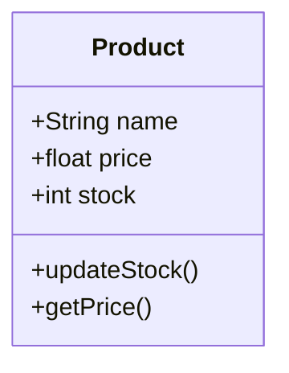
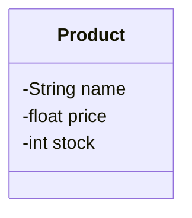
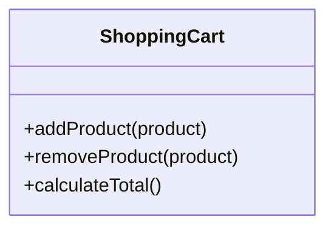
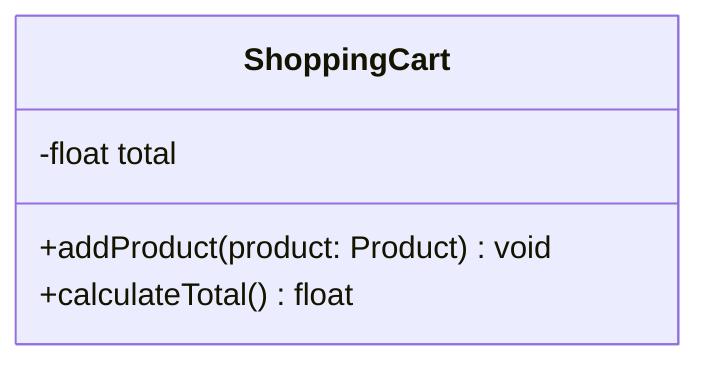
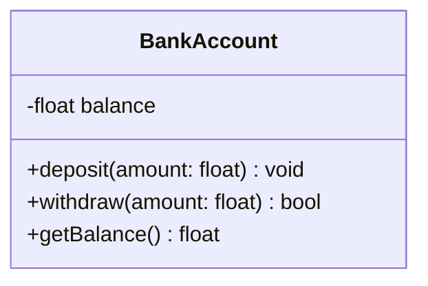
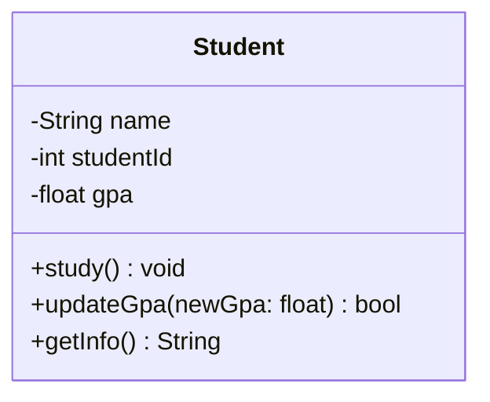
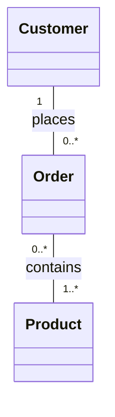
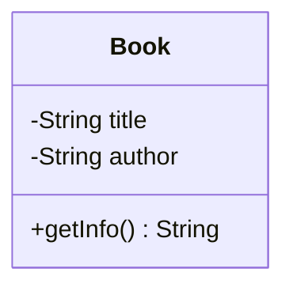

# 03 — Understanding UML Class Diagrams

## 1. What Is a Class Diagram?

A **Class Diagram** is a UML structural diagram that shows the classes in a system and how they are related.

It helps us understand:

- What classes exist in our system.
- What information each class stores.
- What actions each class can perform.
- How different classes are connected.

Imagine you are building an online shopping application.

You might have classes such as:

- `Customer`
- `Product`
- `Order`
- `Payment`

A Class Diagram helps you organize these classes before or during implementation.

**Think of a Class Diagram as a map of your software's structure.**

---

## 2. The Structure of a UML Class

A UML class is usually drawn as a rectangle divided into three sections.



The three sections are:

| Section | Description | Example |
|---|---|---|
| Class Name | Identifies the class | `Product` |
| Attributes | Data stored by objects | `name`, `price`, `stock` |
| Operations | Actions provided by the class | `updateStock()`, `getPrice()` |

Let's understand each part.

---

## 3. Class Name

The first section contains the name of the class.

For example:

`Product`

A class name should clearly describe what the class represents.

Good examples:

- `Customer`
- `ShoppingCart`
- `Payment`
- `OrderItem`

Avoid unclear names such as:

- `Data`
- `Thing`
- `Manager1`

A meaningful name makes the diagram easier to understand.

---

## 4. Attributes: What Does an Object Know?

An **attribute** describes information associated with a class.

For example, a product might have:

- A name
- A price
- A stock quantity

In UML, an attribute commonly follows this format:

`visibility name : type`

For example:

`- price : float`

This means:

- `-` is the visibility.
- `price` is the attribute name.
- `float` is its data type.

In Mermaid, we often write the same information as:



### Common Attribute Types

| Type | Meaning | Example |
|---|---|---|
| `String` | Text | `"Laptop"` |
| `int` | Whole number | `10` |
| `float` | Decimal number | `49.99` |
| `boolean` | True or false | `true` |

These are common programming-style types. UML also allows domain-specific types.

---

## 5. Operations: What Can an Object Do?

An **operation** describes behavior provided by a class.

For example, a shopping cart can:

- Add a product.
- Remove a product.
- Calculate its total.



Operations are written with parentheses `()`.

This makes them easy to distinguish from attributes.

For example:

- `total` is an attribute.
- `calculateTotal()` is an operation.

### Operations with Parameters and Return Types

An operation can accept parameters and return a result.

Consider:

`+ calculateTotal() : float`

This means:

- `+` — Public visibility
- `calculateTotal` — Operation name
- `()` — No parameters
- `float` — Return type

Another example:

`+ addProduct(product : Product) : void`

This means the operation accepts a `Product` and does not return a value.



**Note:** In UML, an operation describes an available behavior. A method is the implementation of that behavior in code.

---

## 6. Visibility: Who Can Access Class Members?

Visibility determines which parts of a program are allowed to access an attribute or operation.

UML uses four common visibility symbols.

| Symbol | Visibility | Meaning |
|---|---|---|
| `+` | Public | Accessible from outside the class |
| `-` | Private | Accessible only within the class |
| `#` | Protected | Accessible within the class and its subclasses |
| `~` | Package | Accessible within the same package |

### Example



Here:

- `balance` is private.
- `deposit()` is public.
- `withdraw()` is public.
- `getBalance()` is public.

Why make `balance` private?

Because we do not want other parts of the program to change it without following the account's rules.

For example, this should not be the intended way to update a balance:

```python
account.balance = -100000
```

Instead, the account should control balance changes through its operations.

### Python Example

```python
class BankAccount:
    def __init__(self, balance=0):
        self.__balance = balance

    def deposit(self, amount):
        if amount <= 0:
            return False

        self.__balance += amount
        return True

    def withdraw(self, amount):
        if amount <= 0 or amount > self.__balance:
            return False

        self.__balance -= amount
        return True

    def get_balance(self):
        return self.__balance


account = BankAccount(100)

account.deposit(50)
account.withdraw(30)

print(account.get_balance())
```

Output:

```text
120
```

The account's balance is managed through its public operations.

**Important Python detail:** Python does not enforce private visibility exactly like UML or languages such as Java. Double underscores trigger name mangling, which discourages accidental access but does not provide absolute privacy.

---

## 7. A Complete Class Example: Student

Imagine a university application.

Each student has:

- A name
- A student ID
- A GPA

Each student can:

- Study
- Update their GPA
- Display their information

### UML Class Diagram



### Python Implementation

```python
class Student:
    def __init__(self, name, student_id, gpa):
        self.__name = name
        self.__student_id = student_id
        self.__gpa = gpa

    def study(self):
        print(f"{self.__name} is studying.")

    def update_gpa(self, new_gpa):
        if 0 <= new_gpa <= 4:
            self.__gpa = new_gpa
            return True

        return False

    def get_info(self):
        return (
            f"Name: {self.__name}, "
            f"ID: {self.__student_id}, "
            f"GPA: {self.__gpa}"
        )


student = Student("Alice", 101, 3.5)

student.study()
student.update_gpa(3.8)

print(student.get_info())
```

Output:

```text
Alice is studying.
Name: Alice, ID: 101, GPA: 3.8
```

### What Did We Learn?

The UML diagram describes the class structure.

The Python code implements that structure and its behavior.

For example:

| UML Element | Python Implementation |
|---|---|
| `Student` | `class Student:` |
| `name : String` | `self.__name` |
| `studentId : int` | `self.__student_id` |
| `study()` | `def study(self):` |
| `updateGpa()` | `def update_gpa(self, new_gpa):` |

The names use different styles because UML examples often use camelCase, while Python commonly uses snake_case.

---

## 8. Relationships Between Classes

So far, we have explored individual classes.

But real software contains multiple classes that work together.

For example:



This diagram introduces relationships between classes.

It tells us:

- A customer can place many orders.
- Each order belongs to one customer.
- Each order contains at least one product.
- A product can appear in multiple orders.

The last relationship is simplified. In a real shopping system, an `OrderItem` class would often store quantities and prices for products in an order.

### Common UML Class Relationships

| Relationship | Main Idea |
|---|---|
| Association | Two classes are connected |
| Generalization | One class is a specialized type of another |
| Aggregation | A whole contains parts that can exist independently |
| Composition | A whole owns parts with dependent lifecycles |
| Dependency | One element uses or depends on another |

We will explore each relationship in its own lesson.

---

## 9. Common Beginner Mistakes

### Mistake 1: Confusing Attributes and Operations

Incorrect:

`calculateTotal`

if you intend to represent an operation.

Better:

`calculateTotal()`

The parentheses show that it is an operation.

### Mistake 2: Making Everything Public

Not every attribute should be accessible or modifiable from outside its class.

Use visibility to communicate the intended access rules.

### Mistake 3: Adding Too Much Detail

A Class Diagram does not always need to show every attribute or operation.

Include the information that is important for understanding the design.

### Mistake 4: Confusing UML with Python Syntax

UML is language-independent.

Its symbols and types describe a design. They do not have to match Python syntax exactly.

### Mistake 5: Thinking One Class Equals One Object

A class can be used to create many objects.

For example, a single `Student` class can describe thousands of students.

---

## 10. Quick Practice

**Question 1**

What are the three main sections of a UML class?

**Question 2**

What is the difference between an attribute and an operation?

**Question 3**

What does the `-` symbol mean in a UML class?

**Question 4**

Consider this operation:

`+ transfer(amount : float) : bool`

What is its name, parameter, return type, and visibility?

**Question 5**

Design a `Book` class with:

- A private title
- A private author
- A public operation to display book information

Try drawing it using Mermaid.

<details>
<summary>Show Answers</summary>

1. Class name, attributes, and operations.
2. An attribute represents data; an operation represents behavior.
3. Private visibility.
4. Name: `transfer`; parameter: `amount` of type `float`; return type: `bool`; visibility: Public.
5. One possible solution:



</details>

---

## 11. Key Takeaways

- A Class Diagram is a UML structural diagram.
- A class commonly contains a name, attributes, and operations.
- Attributes describe information associated with objects.
- Operations describe the behavior provided by a class.
- Visibility controls access to class members.
- UML class diagrams are independent of programming languages.
- Class relationships show how different parts of a system are connected.

---

**Next Lesson:** Generalization and Specialization — Understanding Inheritance and IS-A Relationships.

We will learn how to identify parent and child classes, read inheritance arrows, and recognize incorrect inheritance designs.