# 07 — Multiplicity and Navigability in UML

## 1. Introduction

In the previous lessons, we learned how classes are connected using relationships such as Association, Aggregation, and Composition.

But sometimes, knowing that two classes are connected is not enough.

We also need to answer two important questions:

1. **How many objects can be connected?**
2. **In which direction can we access related objects?**

UML uses two concepts to answer these questions:

- **Multiplicity:** How many objects can participate in a relationship?
- **Navigability:** In which direction can we navigate a relationship?

Let's understand them through simple examples.

---

## 2. What Is Multiplicity?

**Multiplicity** defines how many objects can be connected at one end of a relationship.

Imagine an online shopping system.

We have two classes:

- `Customer`
- `Order`

A customer can place multiple orders.

But each order belongs to exactly one customer.

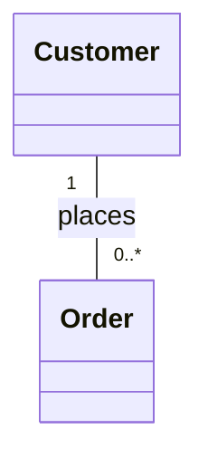

This diagram tells us:

- Each customer can have zero or many orders.
- Each order belongs to exactly one customer.

### The Most Important Rule

**Always read multiplicity from the opposite class.**

For example:

```text
Customer "1" -------- "0..*" Order
```

The `0..*` next to `Order` tells us how many orders **one customer** can have.

The `1` next to `Customer` tells us how many customers **one order** can have.

This is one of the most common points of confusion for beginners.

---

## 3. Common Multiplicity Values

| Multiplicity | Meaning | Example |
|---|---|---|
| `1` | Exactly one | Each order belongs to one customer |
| `0..1` | Zero or one | An employee may have one assigned parking space |
| `0..*` | Zero or many | A customer may have many orders |
| `*` | Zero or many | Another notation for `0..*` |
| `1..*` | One or more | An order must contain at least one item |
| `2..5` | Between two and five | A game requires 2 to 5 players |

Let's explore some examples.

### Example A: Exactly One

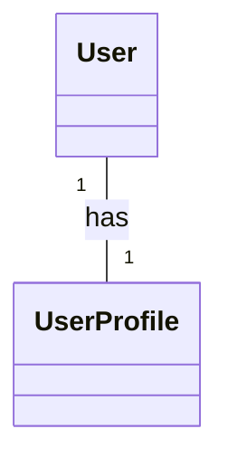

In this particular system:

- Each user has exactly one profile.
- Each profile belongs to exactly one user.

This is a **one-to-one relationship**.

### Example B: Zero or One

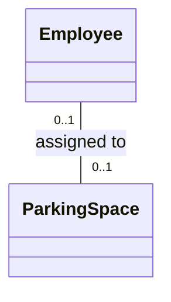

Here:

- An employee may have no assigned parking space or one.
- A parking space may be unassigned or assigned to one employee.

Neither side is required to participate.

### Example C: One-to-Many

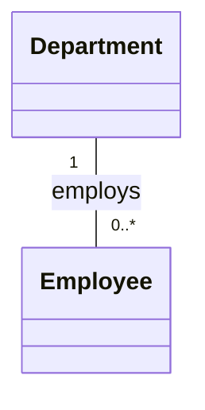

This means:

- One department can have many employees.
- Each employee belongs to exactly one department.

### Example D: Many-to-Many

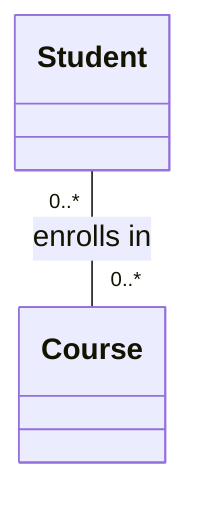

This means:

- One student can enroll in many courses.
- One course can have many students.

For example:

| Student | Courses |
|---|---|
| Alice | Math, Physics |
| Bob | Math, English |
| Sara | Physics |

These are examples based on specific business rules. Multiplicity values may be different in another system.

---

## 4. How to Read Multiplicity Step by Step

Let's use a library system.

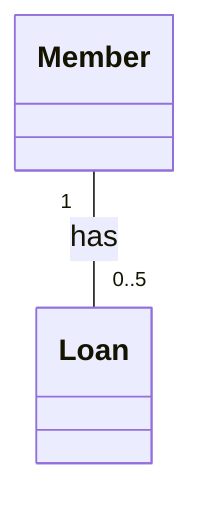

We have:

- `Member`
- `Loan`

Let's read the diagram.

### Step 1: Start with Member

Pick one member.

Look at the number next to `Loan`.

It says:

`0..5`

Therefore, one member can have between zero and five loans.

### Step 2: Start with Loan

Pick one loan.

Look at the number next to `Member`.

It says:

`1`

Therefore, every loan belongs to exactly one member.

### Step 3: Test the Rules

Imagine:

- Alice has 3 loans.
- Bob has 0 loans.
- Sara has 5 loans.

All are valid.

But if Alice has 6 loans, the relationship violates the model's multiplicity constraint.

**Remember:** Multiplicity describes the allowed structure. The application must enforce the relevant rules during implementation.

---

## 5. What Is Navigability?

**Navigability** describes whether an object can navigate an Association to find related objects.

Let's return to the online shopping example.

We have:

- `Customer`
- `Order`

Two questions are possible:

1. Can a customer find their orders?
2. Can an order find its customer?

These are questions about Navigability.

---

## 6. One-Way Navigability

Imagine that a customer can directly access their orders.

But an order does not provide direct navigation back to its customer.

This is called **Unidirectional Navigability**.

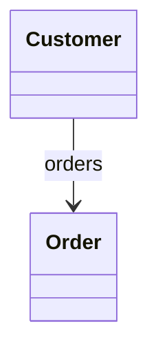

The arrow points toward `Order`.

It indicates navigation from `Customer` to `Order`.

### Python Example

```python
class Order:
    def __init__(self, order_id):
        self.order_id = order_id


class Customer:
    def __init__(self, name):
        self.name = name
        self.orders = []

    def add_order(self, order):
        self.orders.append(order)


alice = Customer("Alice")

order1 = Order(101)
order2 = Order(102)

alice.add_order(order1)
alice.add_order(order2)

print(len(alice.orders))
```

Output:

```text
2
```

Here:

```python
alice.orders
```

works because the customer stores references to the orders.

However:

```python
order1.customer
```

does not work in this implementation because `Order` has no `customer` attribute.

The relationship is navigable only from Customer to Order.

---

## 7. Reverse Navigability

Now imagine the opposite situation.

Each order knows its customer, but the customer does not directly store a list of orders.

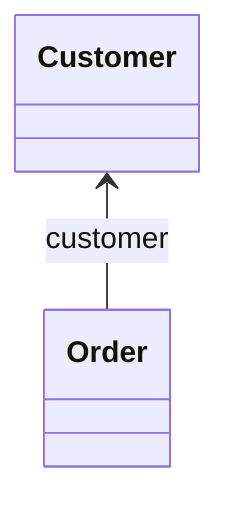

The arrow points toward `Customer`.

This means navigation goes from `Order` to `Customer`.

### Python Example

```python
class Customer:
    def __init__(self, name):
        self.name = name


class Order:
    def __init__(self, order_id, customer):
        self.order_id = order_id
        self.customer = customer


alice = Customer("Alice")
order1 = Order(101, alice)

print(order1.customer.name)
```

Output:

```text
Alice
```

In this design:

```python
order1.customer
```

works.

But:

```python
alice.orders
```

is not directly available.

**Important:** The objects may still be associated even when navigation is available in only one direction.

---

## 8. Bidirectional Navigability

Sometimes we want both sides to access each other.

For example:

- A customer can find their orders.
- An order can find its customer.

This is called **Bidirectional Navigability**.

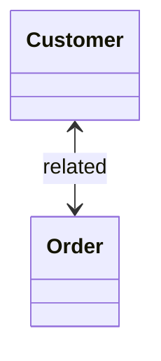

### Python Example

```python
class Customer:
    def __init__(self, name):
        self.name = name
        self.orders = []


class Order:
    def __init__(self, order_id, customer):
        self.order_id = order_id
        self.customer = customer

        customer.orders.append(self)


alice = Customer("Alice")

order1 = Order(101, alice)
order2 = Order(102, alice)

print(len(alice.orders))
print(order1.customer.name)
```

Output:

```text
2
Alice
```

Now both navigation directions are available.

### An Important UML Detail

A normal Association line without arrowheads does **not always mean bidirectional navigability**.

Depending on the modeling convention, the navigation directions may simply be unspecified.

Also, a Mermaid arrow is a visual representation of the intended direction. Mermaid does not implement all the detailed semantics of UML navigability notation.

---

## 9. Multiplicity vs. Navigability

These concepts describe different things.

### Multiplicity

Answers:

**How many objects can be related?**

For example:


One customer can have zero or many orders.

### Navigability

Answers:

**Which object can directly navigate to the other?**

For example:

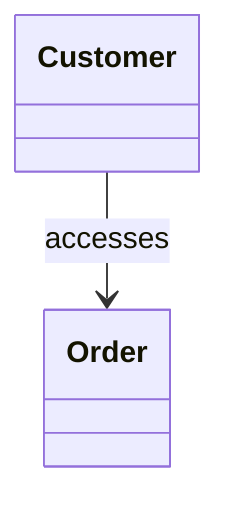

A customer can navigate to its orders.

### Combined Example

We can show both concepts in the same diagram.

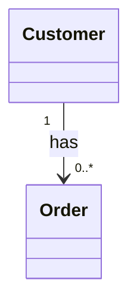

This means:

- One customer can have zero or many orders.
- Every order belongs to one customer.
- Navigation is explicitly shown from Customer to Order.

**Multiplicity does not determine Navigability.**

Even if an order belongs to a customer, the design does not necessarily provide a direct reference from Order to Customer.

---

## 10. A Real-World Example: University System

Imagine a university system with these classes:

- `Department`
- `Professor`
- `Course`

Our requirements are:

1. Each department can have multiple professors.
2. Each professor belongs to one department.
3. Each professor can teach several courses.
4. Each course has exactly one professor.
5. We want departments to find their professors.
6. We want courses to find their assigned professors.

### UML Diagram

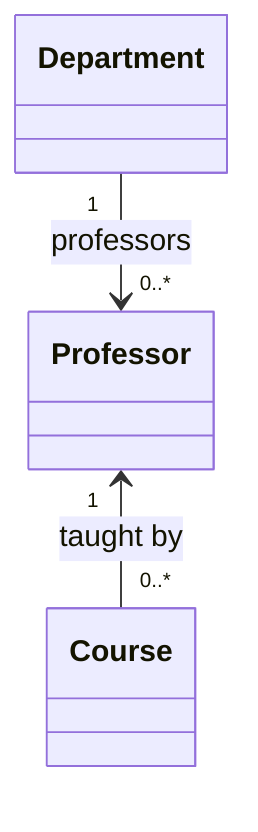

### Reading the First Relationship

`Department → Professor`

- A department has zero or many professors.
- Each professor belongs to one department.
- A department can navigate to its professors.

### Reading the Second Relationship

`Course → Professor`

- A professor can teach zero or many courses.
- Each course has exactly one professor.
- A course can navigate to its professor.

Notice that multiplicity and navigation direction are independent.

The numbers describe quantity.

The arrows describe access direction.

---

## 11. What About Self-Associations?

Multiplicity and Navigability also apply to Self-Associations.

Imagine an employee management system.

Each employee may have one manager.

Each manager may supervise many employees.

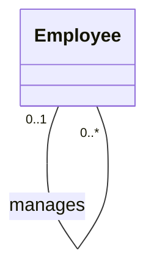

This is a Self-Association because both ends belong to the same class.

However, the ends have different roles:

- **Manager:** Zero or one per employee.
- **Subordinate:** Zero or many per manager.

The association-end roles help us understand the relationship.

This is especially useful when both ends have the same class type.

---

## 12. Common Beginner Mistakes

### Mistake 1: Reading Multiplicity from the Same Side

Incorrect:

"The `0..*` next to Order describes how many customers each order has."

Correct:

"The `0..*` next to Order describes how many orders one customer can have."

Always read from the opposite end.

### Mistake 2: Thinking `0..*` Means At Least One

`0..*` means zero or many.

If you need at least one, use `1..*`.

### Mistake 3: Confusing Multiplicity and Navigability

Multiplicity defines quantity.

Navigability defines the ability to navigate a relationship.

### Mistake 4: Thinking an Arrow Means Data Is Always Sent

A Navigability arrow does not necessarily represent data transfer, an HTTP request, or message flow.

It represents navigation through a relationship.

### Mistake 5: Assuming Every Association Is Bidirectional

A relationship may be navigable in one direction, both directions, or have unspecified navigability.

### Mistake 6: Assuming Multiplicity Is Automatically Enforced

A UML diagram describes design constraints.

Your application or database must enforce the relevant constraints.

---

## 13. Quick Practice

### Question 1

What does `0..1` mean?

### Question 2

Consider:


How many orders can one customer have?

How many customers can one order have?

### Question 3

What is the difference between Multiplicity and Navigability?

### Question 4

Consider:

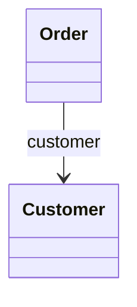

Which direction is navigable?

### Question 5

A course must have at least two students but no more than twenty.

Which multiplicity should be written next to `Student`?

### Question 6

Can an Association have one-to-many multiplicity but only one-way navigability?

<details>
<summary>Show Answers</summary>

1. Zero or one.
2. A customer can have zero or many orders. Each order has exactly one customer.
3. Multiplicity defines how many related objects are allowed. Navigability defines the direction of access.
4. From Order to Customer.
5. `2..20`
6. Yes. Multiplicity and Navigability describe independent aspects of an Association.

</details>

---

## 14. Key Takeaways

- Multiplicity describes the allowed number of related objects.
- Navigability describes how related objects can be accessed.
- Read multiplicity from the opposite class.
- `0..*` means zero or many.
- `1..*` means one or more.
- Navigability can be one-way or two-way.
- Missing navigability arrows do not always mean bidirectional access.
- Multiplicity and Navigability can appear together.
- The two concepts describe different aspects of a relationship.
- UML constraints must be reflected in implementation when required.

---

**Next Lesson:** Object Diagrams — Understanding Object Instances, Attribute Values, and Links.

We will learn how UML represents real objects at a specific moment and how Object Diagrams differ from Class Diagrams.