# 08 — Object Diagrams in UML

## 1. What Is an Object Diagram?

An **Object Diagram** is a UML structural diagram that shows specific objects, their attribute values, and the connections between them at a particular moment.

Think of it as a **snapshot of a running system**.

A Class Diagram describes what kinds of objects can exist.

An Object Diagram shows which objects exist in a particular example and how they are connected.

Let's imagine an online store.

The system has a `Customer` class and an `Order` class.

A Class Diagram can describe how customers and orders are related.

But what if we want to show that Alice has placed two specific orders?

That's where an Object Diagram becomes useful.

---

## 2. Class Diagram vs. Object Diagram

Let's start with a Class Diagram.

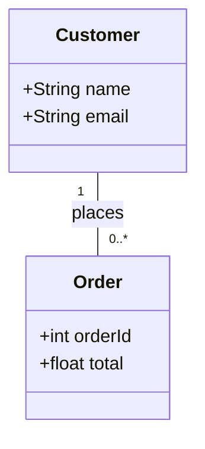

This diagram tells us:

- A customer has a name and email.
- An order has an ID and total amount.
- One customer can place multiple orders.
- Each order belongs to exactly one customer.

However, it does not show any particular customer or order.

Now imagine:

- Alice is a customer.
- Alice has placed Order #101.
- Alice has also placed Order #102.

We want to show these actual objects and their connections.

### Object-Level View

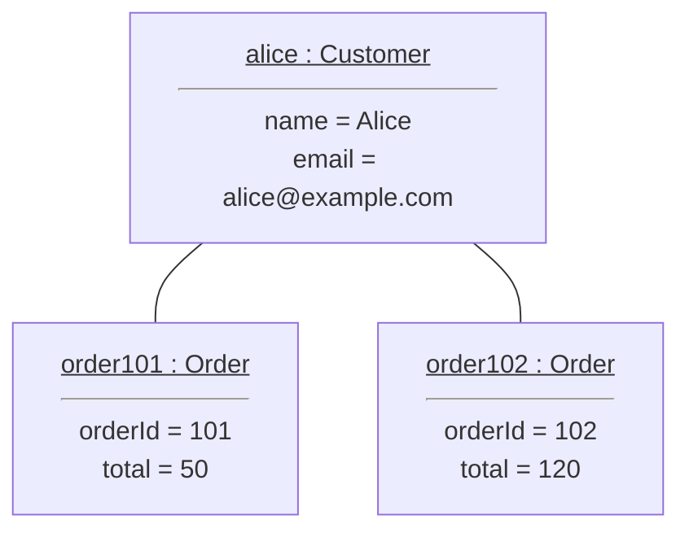

This Mermaid flowchart illustrates an Object Diagram.

It is a visual approximation because Mermaid does not have a dedicated UML Object Diagram syntax.

### What Is the Difference?

| Class Diagram | Object Diagram |
|---|---|
| Shows classes | Shows specific objects |
| Defines attributes | Shows actual attribute values |
| Defines associations | Shows links |
| Describes general structure | Shows a particular snapshot |
| Example: `Customer` | Example: `alice:Customer` |

**Remember:** A Class Diagram is like a blueprint. An Object Diagram is like a photograph of a specific situation.

---

## 3. How to Read an Object

In UML, an object is commonly written using this format:

`objectName : ClassName`

For example:

`alice : Customer`

This means:

- `alice` is the object name.
- `Customer` is the class.
- The object is an instance of the `Customer` class.

### Object Attributes

Objects can also display their current attribute values.

For example:

```text
alice : Customer
-------------------------
name = "Alice"
email = "alice@example.com"
```

In a formal UML Object Diagram, the object name and class name are normally underlined.

### Another Example

Consider:

`car1 : Car`

With these values:

```text
brand = "Toyota"
color = "Red"
speed = 60
```

This tells us about one specific car.

It does not describe every car created from the `Car` class.

---

## 4. Classes Can Have Multiple Objects

Imagine we have one class:

`Student`

But three students:

- Alice
- Bob
- Sara

All three are objects of the same class.

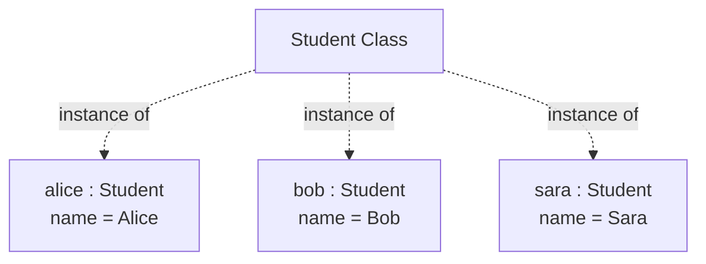

This is a conceptual illustration of instances, not formal UML instance notation.

The important idea is:

**One class can have many different objects.**

Each object has its own identity and attribute values.

---

## 5. Object Identity vs. Object State

Two objects can have identical attribute values and still be different objects.

Let's see an example.

```python
class Car:
    def __init__(self, brand, color):
        self.brand = brand
        self.color = color


car1 = Car("Toyota", "Red")
car2 = Car("Toyota", "Red")
```

Both objects have the same values:

- Brand: Toyota
- Color: Red

But they are separate objects.

```python
print(car1 is car2)
```

Output:

```text
False
```

Why?

Because Python created two different objects.

### What Is Object Identity?

**Identity** tells us which specific object we are talking about.

### What Is Object State?

**State** describes the current attribute values of an object.

For example:

```python
car1.color = "Black"
```

Now `car1` has changed its state.

But `car2` is still red.

```python
print(car1.color)  # Black
print(car2.color)  # Red
```

The objects remain separate.

---

## 6. What Is a Link?

In the Association lesson, we learned that an Association describes a relationship between classes.

A **Link** is a specific connection between objects.

Let's use our shopping example.

### Association in a Class Diagram

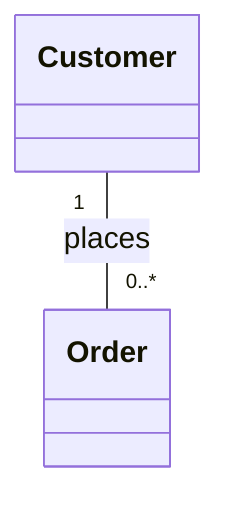

This relationship says customers can be connected to orders.

### Links in an Object Diagram

Imagine:

- Alice has Order #101.
- Alice has Order #102.
- Bob has Order #103.

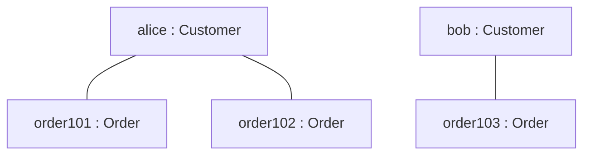

There are three Links:

1. Alice is connected to Order #101.
2. Alice is connected to Order #102.
3. Bob is connected to Order #103.

### Important Difference

**Association = Relationship between classes**

**Link = Relationship between particular objects**

A Link does not represent inheritance.

It represents an existing connection between instances.

---

## 7. Object Diagrams and Multiplicity

Object Diagrams can help us understand multiplicity rules.

Consider this Class Diagram:


The rules are:

- One customer can have zero or many orders.
- Every order must belong to exactly one customer.

Now imagine this Object Diagram:

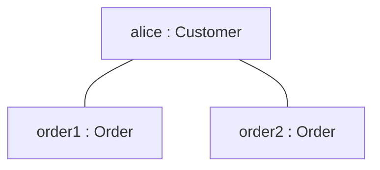

Does it follow the rules?

Yes.

Alice has two orders.

Both orders belong to exactly one customer.

### Invalid Example

Now imagine an order connected to two customers.

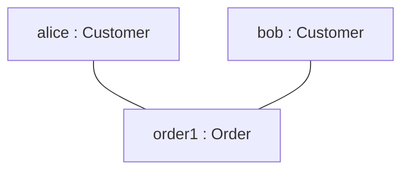

This violates our Class Diagram's multiplicity rule.

Why?

Because the model says each order belongs to exactly one customer.

But `order1` is connected to both Alice and Bob.

**Object Diagrams can help us test whether a particular object configuration follows the class model.**

---

## 8. Self-Association in Object Diagrams

Sometimes objects of the same class are connected to each other.

Imagine a company where employees can manage other employees.

We have one class:

`Employee`

And three objects:

- Alice
- Bob
- Sara

Alice manages Bob and Sara.

### Class Diagram

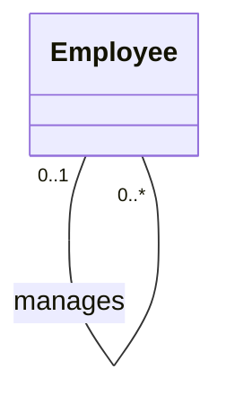

### Object-Level View

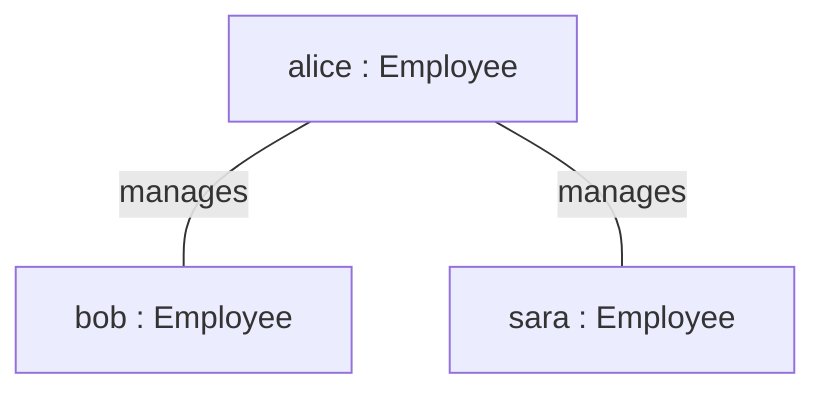

All three objects are instances of the `Employee` class.

The connections between them are Links of the self-association.

**Important:** Alice is not a superclass of Bob or Sara.

They are separate objects of the same class.

---

## 9. A Complete Example in Python

Let's implement the online shopping example.

### Step 1: Define the Classes

```python
class Customer:
    def __init__(self, name, email):
        self.name = name
        self.email = email
        self.orders = []


class Order:
    def __init__(self, order_id, total, customer):
        self.order_id = order_id
        self.total = total
        self.customer = customer

        customer.orders.append(self)
```

### Step 2: Create Objects

```python
alice = Customer("Alice", "alice@example.com")
bob = Customer("Bob", "bob@example.com")

order101 = Order(101, 50, alice)
order102 = Order(102, 120, alice)
order103 = Order(103, 75, bob)
```

We now have five objects:

- Two `Customer` objects.
- Three `Order` objects.

### Step 3: Access Object Relationships

```python
print(len(alice.orders))
print(len(bob.orders))

print(order101.customer.name)
print(order103.customer.name)
```

Output:

```text
2
1
Alice
Bob
```

### Step 4: Visualize the Objects

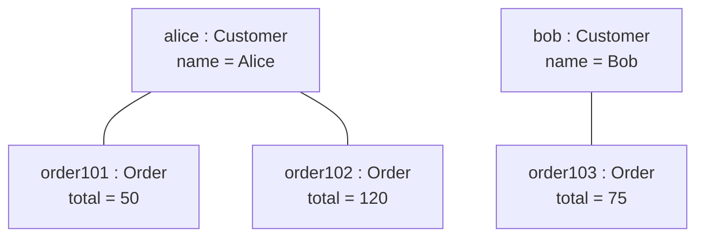

This visualization represents the object relationships created in Python.

The Class Diagram describes the possible structure.

The Object Diagram shows a particular instance of that structure.

---

## 10. When Should We Use Object Diagrams?

Object Diagrams are useful when we want to:

- Show examples of class instances.
- Explain relationships between actual objects.
- Understand a particular system state.
- Validate multiplicity constraints.
- Demonstrate self-associations.
- Document complex object structures.
- Explain how a class design works with real examples.

Object Diagrams are especially useful when a Class Diagram feels too abstract.

---

## 11. Common Beginner Mistakes

### Mistake 1: Confusing Objects with Classes

`Customer` is a class.

`alice:Customer` describes an object.

They are not the same thing.

### Mistake 2: Thinking Links Are Inheritance

A Link connects objects.

Inheritance describes a type hierarchy between classes.

### Mistake 3: Thinking Object Diagrams Show Every Possible Object

An Object Diagram usually shows only a particular situation.

It does not need to show every object that could exist in the system.

### Mistake 4: Confusing Attribute Types with Attribute Values

In a Class Diagram:

`name : String`

In an Object Diagram:

`name = "Alice"`

One defines the type of data.

The other shows its current value.

### Mistake 5: Assuming Mermaid Fully Supports UML Object Diagrams

Mermaid can represent objects using flowcharts or class diagrams.

However, these are approximations.

Some UML details, such as formal instance notation and underlined object names, may not be represented exactly.

---

## 12. Quick Practice

### Question 1

What is an Object Diagram?

### Question 2

What is the difference between a Class Diagram and an Object Diagram?

### Question 3

What does `alice:Customer` mean?

### Question 4

What is a Link in UML?

### Question 5

Consider:

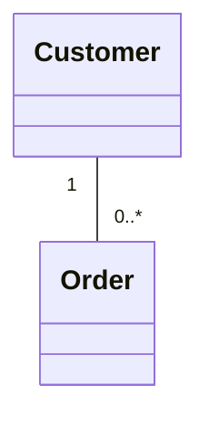

Alice has three orders.

How many Links should connect Alice to those orders in an Object Diagram?

### Question 6

Two objects have exactly the same attribute values.

Does that mean they are the same object?

### Question 7

Can an Object Diagram contain multiple objects created from the same class?

<details>
<summary>Show Answers</summary>

1. An Object Diagram shows specific objects, their attribute values, and their connections at a particular moment.
2. A Class Diagram describes general class structure. An Object Diagram shows a specific object configuration.
3. An object named `alice` that is an instance of the `Customer` class.
4. A Link is a specific connection between objects, usually representing an instance of an Association.
5. Three Links.
6. No. Different objects can have identical attribute values but different identities.
7. Yes. One class can have many instances.

</details>

---

## 13. Key Takeaways

- Object Diagrams are UML structural diagrams.
- They show specific objects and their relationships.
- An Object Diagram represents a snapshot of a system.
- Objects are instances of classes.
- Objects have identity and state.
- Attribute values describe an object's current state.
- Links represent connections between objects.
- Links are instances of associations.
- Object Diagrams help validate Class Diagram rules.
- Multiple objects can belong to the same class.
- Mermaid flowcharts can approximate Object Diagrams, but they do not fully support formal UML notation.

---

**Next Lesson:** Package Diagrams — Organizing Software into Packages and Understanding Dependencies.

We will learn how to organize a large system into smaller logical parts and how to show relationships between those parts.