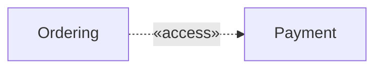
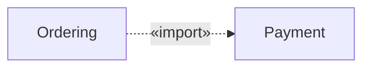
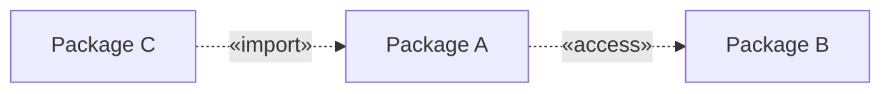
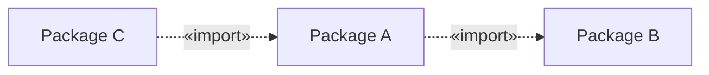
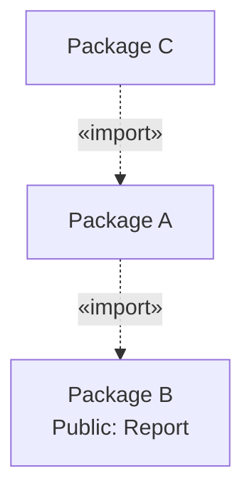
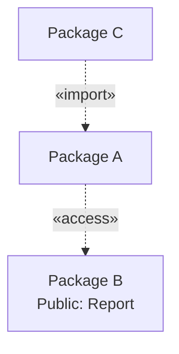
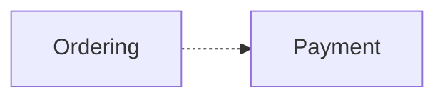
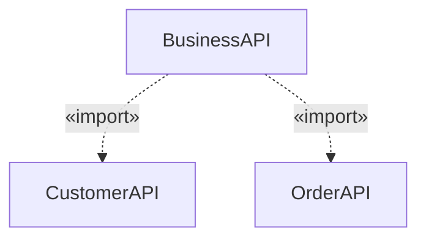
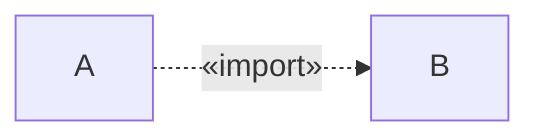

# 10 — Package Access vs. Import in UML

## 1. Introduction

In the previous lesson, we learned that a **Package Diagram** shows how packages are organized and how they depend on each other.

Now imagine an online shopping system with three packages:

- `Payment` — Handles payments.
- `Ordering` — Manages orders.
- `UI` — Displays the user interface.

The Ordering package needs to use some functionality from Payment.

But here is an important question:

**Should Ordering only use Payment internally, or should it also make Payment's public elements available through Ordering?**

UML provides two relationships to describe these situations:

- **Package Access (`«access»`)**
- **Package Import (`«import»`)**

Let's understand their differences.

---

## 2. Understanding Package Visibility

Before learning Access and Import, we need to understand **Visibility**.

Visibility describes whether an element can be seen or accessed from another part of a model.

Imagine the `Payment` package contains:

- `PaymentService`
- `PaymentValidator`
- `PaymentHelper`

Not every element needs to be publicly available.

For example:

```text
Payment
├── + PaymentService
├── + PaymentValidator
└── - PaymentHelper
```

In UML:

| Symbol | Visibility | Meaning |
|---|---|---|
| `+` | Public | Can be visible outside its package |
| `-` | Private | Not publicly visible outside its package |

In our example:

- `PaymentService` is public.
- `PaymentValidator` is public.
- `PaymentHelper` is private.

Other packages may use the public elements through appropriate relationships.

However, they should not treat private elements as part of Payment's public interface.

**Important:** Public visibility alone does not automatically create a dependency or import relationship between packages.

---

## 3. What Is Package Access?

**Package Access allows one package to use the public elements of another package without making those imported elements publicly visible through itself.**

Let's imagine:

- `Ordering` needs `PaymentService`.
- `PaymentService` belongs to `Payment`.

We can model this using Package Access.

### UML Concept

```text
Ordering - - - - - > Payment
          «access»
```

### Mermaid Diagram



This is a Mermaid approximation of the UML relationship.

### How to Read It

The arrow points from `Ordering` to `Payment`.

This means:

1. Ordering accesses the public elements of Payment.
2. Those elements are available for Ordering's internal use.
3. Ordering does not publicly re-export those imported elements.

### Real-World Example

Imagine Ordering uses the following service:

`Payment::PaymentService`

Ordering can use this service to process payments.

But another package does not automatically gain access to PaymentService through Ordering.

### Simple Rule

**Package Access = Use another package's public elements without publicly re-exporting them.**

---

## 4. What Is Package Import?

**Package Import allows one package to import the public elements of another package and make those imported elements publicly visible through its own namespace.**

Let's use the same example.

Ordering imports Payment.

### UML Concept

```text
Ordering - - - - - > Payment
          «import»
```

### Mermaid Diagram



At first, this looks almost identical to Package Access.

The main difference is what happens to the visibility of the imported elements.

### What Happens?

Suppose Payment contains a public class:

`PaymentService`

When Ordering imports Payment:

1. Ordering can use PaymentService.
2. PaymentService becomes publicly visible as an imported member in Ordering's namespace.
3. Another package may see PaymentService through Ordering if the appropriate import relationships are established.

This behavior is sometimes described as **transitive visibility**.

### Simple Rule

**Package Import = Use another package's public elements and expose those imported elements through your package's public namespace.**

---

## 5. The Most Important Difference

Let's compare the two relationships using three packages:

- `A`
- `B`
- `C`

Suppose Package B contains a public class called `Service`.

Package A needs to use this class.

### Situation A: Package Access

Package A accesses Package B.

Package C imports Package A.



What happens?

- A can use B's public Service.
- A does not publicly re-export Service.
- C does not receive Service from B through A.

C would need its own appropriate relationship to B to import that Service.

### Situation B: Package Import

Now Package A imports Package B.

Package C imports Package A.



What happens?

- A imports B's public Service.
- Service becomes publicly visible through A.
- C can import the publicly visible Service through A, subject to UML namespace and name-resolution rules.

### Comparison Table

| Feature | `«access»` | `«import»` |
|---|---|---|
| Uses public elements from another package | Yes | Yes |
| Imported visibility in the receiving package | Private | Public |
| Publicly re-exports imported elements | No | Yes |
| Supports visibility through later imports | Not through this access | Yes |
| UML arrow | Dashed, open arrow | Dashed, open arrow |

**Remember:**

Access is for private use.

Import is for public reuse through another package's namespace.

---

## 6. Understanding Transitive Visibility

The word *transitive* may sound complicated, but the idea is simple.

Imagine three packages:

```text
C → A → B
```

Package B contains a public class called `Report`.

Package A imports B.

Package C imports A.

If both relationships use public Package Import, `Report` can become visible to C through A.

This is transitive visibility.

### Visual Example



Now change the relationship between A and B to Package Access:



In this case:

- A can use Report.
- C cannot obtain Report through A's public imports.

### Important Detail

Transitive visibility concerns which element names are available through imported namespaces.

It does **not** automatically mean that C can use every private implementation detail inside B.

It also does not mean that every dependency is automatically transitive.

---

## 7. A Simple Python Analogy

Let's see a practical analogy using Python.

**Important:** Python imports and UML Package Imports are not identical. The following examples only illustrate the idea of using functionality internally versus exposing it through a public interface.

Imagine this project:

```text
shop/
├── payments/
│   ├── __init__.py
│   └── services.py
│
├── orders/
│   ├── __init__.py
│   └── services.py
│
└── app.py
```

### Step 1: Create the Payment Service

File: `payments/services.py`

```python
class PaymentService:
    def process(self, amount):
        print(f"Processing ${amount}")
```

### Step 2: Internal Use — Similar to Package Access

File: `orders/services.py`

```python
from payments.services import PaymentService


class OrderService:
    def checkout(self, amount):
        payment = PaymentService()
        payment.process(amount)
```

Ordering uses PaymentService internally.

Other modules can use `OrderService` without needing to know how payments are implemented.

To keep the intended public API clear, we can export only `OrderService` from the orders package.

File: `orders/__init__.py`

```python
from .services import OrderService

__all__ = ["OrderService"]
```

The public API of `orders` is intended to expose `OrderService`, not `PaymentService`.

### Step 3: Public Re-export — Similar to Package Import

Suppose we want the orders package to publicly expose PaymentService as well.

File: `orders/__init__.py`

```python
from .services import OrderService
from payments.services import PaymentService

__all__ = ["OrderService", "PaymentService"]
```

Now another module can write:

```python
from orders import PaymentService

payment = PaymentService()
payment.process(100)
```

This demonstrates public re-exporting.

### What Is the Difference?

In the first design, PaymentService is an internal implementation dependency of Ordering.

In the second design, Ordering intentionally exposes PaymentService as part of its public API.

This resembles the difference between UML Package Access and Package Import.

**Python detail:** `__all__` defines names used by wildcard imports and can document the intended public API, but it is not an access-control mechanism. Python does not enforce UML package visibility rules directly.

---

## 8. Package Access vs. Dependency

You might wonder:

**Is Package Access the same as an ordinary Dependency?**

Not exactly.

A normal Dependency means one element relies on another.

For example:



This tells us that Ordering depends on Payment.

But it does not explain exactly how imported element visibility works.

Package Access gives us more specific information.


This tells us that public elements of Payment are imported with private visibility into Ordering.

Package Import also gives specific visibility information, but with public visibility.

### Comparison

| Relationship | Main Meaning |
|---|---|
| Dependency | One element relies on another |
| Package Access | Import public elements for private use |
| Package Import | Import public elements with public visibility |

In UML, Access and Import are specialized package-import relationships with dependency-like notation.

---

## 9. When Should We Use Access or Import?

Let's use a practical example.

Imagine an application with:

- `Payment`
- `Ordering`
- `UI`

### Choose Package Access When...

Ordering needs Payment internally, but you do not want Payment's elements to appear as public members imported through Ordering.

For example:

Ordering uses a payment validation class internally.

Other packages should not rely on Ordering to expose that class.

### Choose Package Import When...

You intentionally want to make another package's public model elements available through your package.

For example:

A package named `BusinessAPI` may import public elements from `CustomerAPI` and `OrderAPI` to provide a larger public model namespace.



The BusinessAPI package makes the imported public elements available through its namespace.

### Design Advice

Do not publicly expose internal dependencies unless there is a reason to do so.

A clear public interface makes it easier to change implementation details without affecting other parts of the system.

---

## 10. Common Beginner Mistakes

### Mistake 1: Thinking Access and Import Are Identical

Both provide access to public package elements.

However, they differ in the visibility of the imported elements.

### Mistake 2: Thinking Import Exposes Private Elements

Package Import imports eligible public elements.

It does not automatically expose private members from the supplier package.

### Mistake 3: Reading the Arrow Backward

Consider:

`A → B`

A is the importing or accessing package.

B is the package whose public elements are being used.

The arrow points toward the supplier.

### Mistake 4: Confusing UML Import with Python Import

The word "import" appears in both UML and Python.

However, the two systems have different rules.

Do not assume that a Python import statement automatically corresponds to UML `«import»`.

### Mistake 5: Assuming Every Dependency Is Transitive

Ordinary dependencies do not automatically provide transitive visibility.

The rules of Package Import determine whether imported public elements can become visible through another package.

### Mistake 6: Ignoring Name Conflicts

Importing public elements from multiple packages may introduce names that conflict.

For example, two packages might both contain a public class named `Service`.

UML namespace and name-resolution rules must be considered.

---

## 11. Quick Practice

### Question 1

What is the main difference between Package Access and Package Import?

### Question 2

Package A wants to use public classes from Package B, but it does not want to make those classes publicly visible through A.

Which relationship should A use?

### Question 3

Consider this diagram:



Which package imports the other?

### Question 4

If Package A imports Package B, can A automatically access B's private elements?

### Question 5

What is transitive visibility?

### Question 6

Package C imports Package A.

Package A accesses Package B using `«access»`.

Can C obtain B's public elements through A's imports?

<details>
<summary>Show Answers</summary>

1. Access imports public elements with private visibility, while Import imports them with public visibility.
2. Package Access.
3. Package A imports Package B.
4. No. Package Import does not automatically expose private elements.
5. Publicly imported elements can become visible through further package imports, according to UML's import and namespace rules.
6. No. A's access to B does not publicly re-export B's elements through A.

</details>

---

## 12. Key Takeaways

- UML packages can contain public and private elements.
- Package Access and Package Import both work with publicly visible elements of another package.
- `«access»` imports those elements with private visibility.
- `«import»` imports those elements with public visibility.
- Public Package Import supports transitive visibility through further imports.
- Ordinary Dependency does not define package-import visibility.
- The dependency arrow points toward the supplier package.
- Python imports can help explain the concept, but they are not identical to UML Package Imports.
- Clear package interfaces help reduce unnecessary coupling.

---

**Next Lesson:** Composite Structure Diagrams — Understanding Parts, Roles, Connectors, and Internal Structure.

We will explore how UML represents the internal structure of a class or system and how its parts work together.