# 09 — Package Diagrams in UML

## 1. What Is a Package Diagram?

A **Package Diagram** is a UML structural diagram that shows how a system is organized into packages and how those packages depend on each other.

Imagine you are building a large online shopping application.

The application needs to manage:

- Customers
- Products
- Orders
- Payments
- Shipping

Putting everything in one place would make the system difficult to understand and maintain.

Instead, we can divide the application into smaller, logical parts called **packages**.

Each package groups related elements of the system.

A Package Diagram helps us see how these groups are organized and connected.

**Think of a Package Diagram as a map of your software's organization.**

---

## 2. What Is a Package?

A **Package** is a container used to organize related model elements.

For example, a package called `Payment` might contain:

- `PaymentService`
- `PaymentValidator`
- `PaymentTransaction`

All these elements are related to payment functionality.

### Simple Example

Imagine this project structure:

```text
OnlineShop/
├── users/
├── products/
├── orders/
├── payments/
└── shipping/
```

Each folder represents a different part of the application.

In UML, we can organize the corresponding model elements into packages.

### Package Diagram

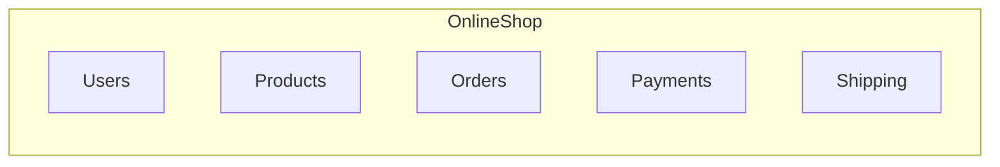

This Mermaid diagram shows a conceptual package organization.

**Important:** A UML package is a logical grouping. It does not have to match a physical folder in your source code.

Mermaid does not provide dedicated UML Package Diagram notation, so we use flowcharts and subgraphs to illustrate packages throughout this lesson.

---

## 3. Why Do We Need Packages?

Imagine an application with 200 classes.

Without organization, understanding the relationships between these classes becomes difficult.

Packages help us divide the model into smaller parts.

### Benefits of Packages

**1. Better Organization**

Related classes and interfaces are grouped together.

**2. Easier Maintenance**

Developers can understand and modify specific parts of the system more easily.

**3. Clear Responsibilities**

Each package can focus on a particular responsibility.

**4. Better Communication**

Package Diagrams help developers understand the overall software structure without studying every class.

**5. Dependency Management**

We can see which packages rely on other packages.

However, dividing a system into packages does not automatically make it well-designed. The dependencies between packages also matter.

---

## 4. How Packages Contain Other Elements

A package can contain classes, interfaces, and even other packages.

For example, our `Ordering` package might contain:

- `Order`
- `OrderItem`
- `OrderService`

### Visual Example

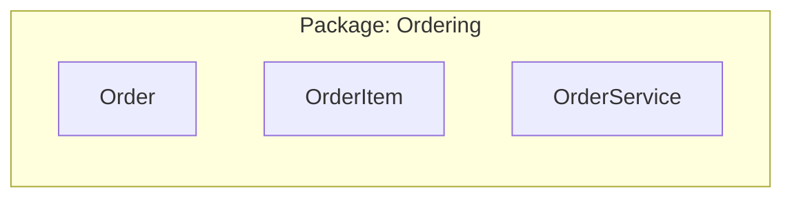

This shows that the three elements belong to the same logical package.

A package can also contain another package.

For example:

```text
OnlineShop/
└── Payment/
    ├── Processing/
    └── Refunds/
```

Here:

- `OnlineShop` contains `Payment`.
- `Payment` contains `Processing` and `Refunds`.

This is called **package nesting**.

### Nested Package Example

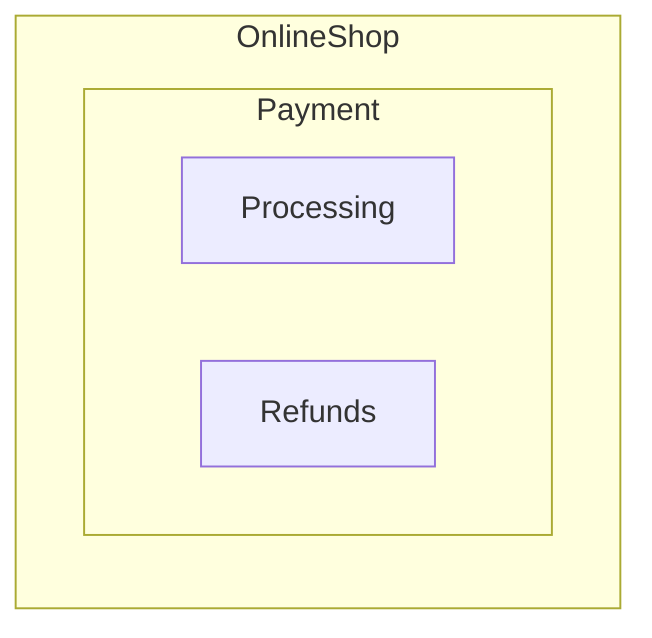

This helps organize large systems into multiple levels.

---

## 5. What Is Dependency?

This is the most important concept in Package Diagrams.

A **Dependency** means that one element relies on another element.

For example, suppose the `Ordering` package uses a payment service from the `Payment` package.

We can say:

**Ordering depends on Payment.**

### UML Dependency

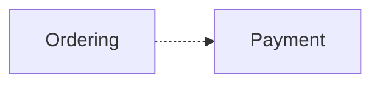

The dashed arrow represents Dependency.

In a formal UML diagram, a Dependency is drawn using a dashed line with an open arrowhead.

### How to Read the Arrow

The arrow starts from the **dependent package** and points toward the **package it depends on**.

In this example:

- `Ordering` is the client or dependent package.
- `Payment` is the supplier package.

We read the relationship as:

"Ordering depends on Payment."

### Why Does This Matter?

If Payment changes the functionality or interface that Ordering uses, Ordering might also need to change.

For example:

Suppose Ordering calls a payment operation:

`createPayment(orderId, amount)`

Later, Payment changes its interface to require an additional parameter.

Ordering may need to update its code to use the new interface.

This is why dependencies are important when designing software.

---

## 6. A Real-World Example: Online Shopping

Let's design a simple online shopping system.

Our application contains five packages:

- `UI` — Handles user interaction.
- `Ordering` — Manages orders.
- `Payment` — Processes payments.
- `Shipping` — Manages deliveries.
- `Inventory` — Manages product stock.

### Package Dependency Diagram

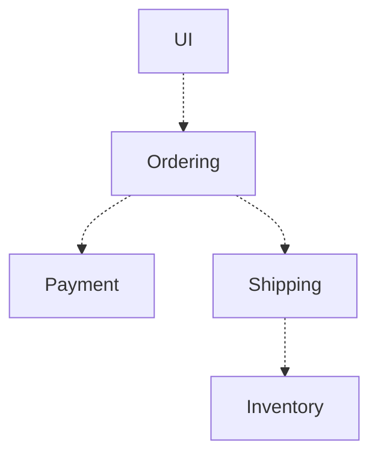

### Reading the Diagram

**UI → Ordering**

The user interface depends on the ordering functionality.

For example, when a customer clicks "Place Order", the UI uses the Ordering package.

**Ordering → Payment**

Ordering uses payment functionality when processing an order.

**Ordering → Shipping**

Ordering uses shipping functionality to arrange delivery.

**Shipping → Inventory**

Shipping uses inventory functionality to check product availability.

### Important Note

The arrows represent dependencies between software packages.

They do not necessarily represent HTTP requests, network connections, or runtime message flows.

A dependency might exist because one package uses a class, interface, function, or another element from a different package.

---

## 7. Package Dependencies in Python

Let's connect the UML concept to actual code.

Imagine this Python project:

```text
shop/
├── orders/
│   ├── __init__.py
│   └── services.py
│
└── payments/
    ├── __init__.py
    └── services.py
```

The Payment package contains a function that processes payments.

### Payment Code

File: `payments/services.py`

```python
def process_payment(amount):
    print(f"Processing payment: ${amount}")
    return True
```

### Ordering Code

File: `orders/services.py`

```python
from payments.services import process_payment


def create_order(product, amount):
    print(f"Creating order for {product}")

    payment_success = process_payment(amount)

    if payment_success:
        print("Order created successfully.")
```

### Using the Code

```python
from orders.services import create_order

create_order("Laptop", 1000)
```

Output:

```text
Creating order for Laptop
Processing payment: $1000
Order created successfully.
```

### What Is the Dependency?

The Ordering package imports and uses a function from the Payment package.

Therefore:

`Ordering → Payment`


This is a simple example of a package dependency in code.

**Note:** A Python import is one way a dependency can appear. UML Dependency is a broader modeling concept and is not limited to import statements.

---

## 8. What Is Circular Dependency?

A **Circular Dependency** happens when dependencies form a cycle.

Let's imagine two packages:

- `Ordering`
- `Payment`

Ordering uses Payment to process payments.

But Payment also depends on Ordering to obtain order information.

### Circular Dependency Diagram

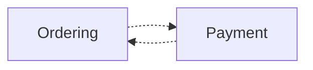

Both packages depend on each other.

This is a dependency cycle.

### Why Can This Be a Problem?

Circular dependencies may cause:

- More tightly coupled modules.
- Difficult unit testing.
- Complicated maintenance.
- Unexpected effects when changing code.
- Circular import problems in some programming languages.

For example, in Python, importing modules that also import each other can sometimes cause initialization errors.

However, not every circular dependency automatically causes a Python import error.

### A Larger Dependency Cycle

A cycle can also involve more than two packages.

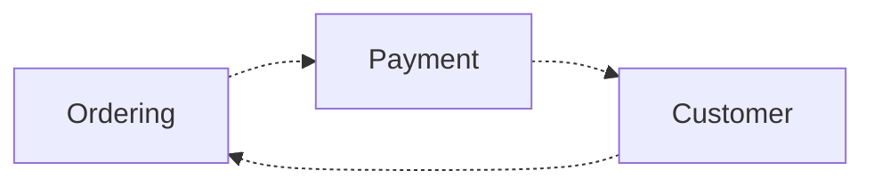

Here:

- Ordering depends on Payment.
- Payment depends on Customer.
- Customer depends on Ordering.

Together, they form a cycle.

### A Better Design

Suppose Payment only needs the order ID and payment amount.

Instead of making Payment depend on the entire Ordering package, we can pass the required information as parameters.

```python
# payments/services.py

def process_payment(order_id, amount):
    print(f"Processing payment for order {order_id}")
    return True
```

Then Ordering can call Payment:

```python
# orders/services.py

from payments.services import process_payment


def create_order(order_id, amount):
    return process_payment(order_id, amount)
```

Now Payment does not need to import Ordering.

The dependency can remain one-way:


This design reduces unnecessary coupling.

In larger systems, shared interfaces or a separate common module may also help remove dependency cycles.

**Important:** Passing parameters is not enough to solve every circular dependency. The best solution depends on the responsibilities of the packages.

---

## 9. Dependency vs. Association

We previously learned about Association in Class Diagrams.

Both Association and Dependency connect UML elements, but they describe different concepts.

### Association

A customer is related to an order.

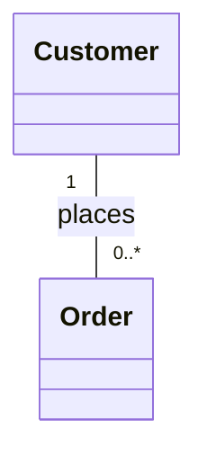

This is a structural relationship between classes.

### Dependency

The Ordering package uses functionality from the Payment package.


This is a dependency between packages.

### Main Differences

| Association | Dependency |
|---|---|
| Describes a structural relationship | Describes reliance between elements |
| Commonly used between classes | Can be used between classes, packages, and other elements |
| Uses a solid line | Uses a dashed arrow |
| Can have multiplicity | Does not use Association-end multiplicity |
| Example: Customer and Order | Example: Ordering uses Payment |

A dependency is often weaker than a structural Association, but the exact meaning depends on the elements being modeled.

---

## 10. What Is Package Visibility?

Not every element inside a package must be available to other packages.

Some elements are intended for external use.

Other elements are internal implementation details.

For example:

The Payment package might contain:

- `PaymentService` — Public
- `PaymentValidator` — Internal
- `PaymentHelper` — Internal

Other packages should use the public interface rather than depending on every internal implementation detail.

In UML, package members may have visibility rules such as:

| Symbol | Visibility |
|---|---|
| `+` | Public |
| `-` | Private |

### Why Is Visibility Useful?

It helps distinguish between:

- Elements a package exposes for other packages to use.
- Elements intended to remain internal.

This reduces unnecessary dependencies on internal implementation details.

### Package Access and Package Import

UML also defines two important relationships:

- `«access»`
- `«import»`

Both involve access to public elements of another package, but they differ in whether imported elements become publicly visible through the importing package.

We will explain these relationships in detail in the next lesson.

---

## 11. Package Diagram vs. Class Diagram

A Class Diagram shows classes and their relationships.

A Package Diagram focuses on how model elements are organized into packages and how packages depend on one another.

### Class Diagram Example

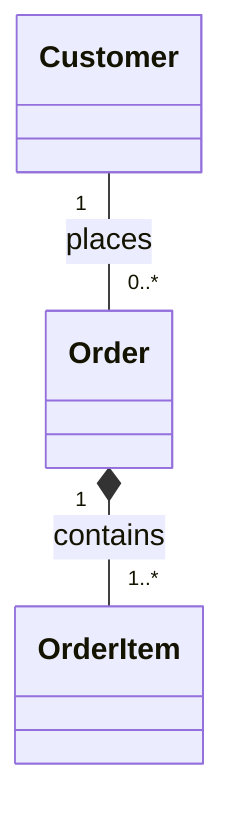

This focuses on classes and their relationships.

### Package Diagram Example

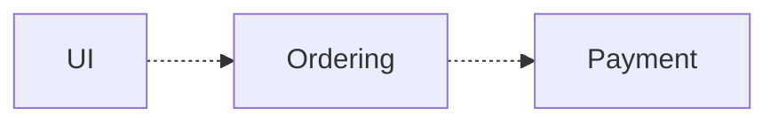

This focuses on high-level dependencies.

### Comparison

| Class Diagram | Package Diagram |
|---|---|
| Focuses on classes | Focuses on packages |
| Shows attributes and operations | Shows logical organization |
| Shows relationships between classes | Shows dependencies between packages |
| Useful for detailed structural design | Useful for organizing and understanding larger models |

Both diagrams are useful, but they answer different questions.

---

## 12. When Should We Use Package Diagrams?

Package Diagrams are useful when:

- Designing a modular application.
- Organizing large software models.
- Understanding dependencies between subsystems.
- Planning software architecture.
- Finding unnecessary dependency cycles.
- Documenting the logical structure of an existing project.

For example, before developing a large Django application, a Package Diagram can help you decide which modules should depend on which others.

It can also help identify dependencies that should be reduced or removed.

You do not need a Package Diagram for every small application.

Use it when it makes the software easier to understand.

---

## 13. Common Beginner Mistakes

### Mistake 1: Thinking a Package Is Always a Folder

A UML Package is a logical modeling concept.

It may correspond to a source-code folder, but it does not have to.

### Mistake 2: Reading Dependency Arrows Backward

Consider:

`Ordering → Payment`

This means Ordering depends on Payment.

The arrow points toward the supplier.

### Mistake 3: Thinking Dependencies Always Represent HTTP Requests

A dependency can be caused by using a function, class, interface, or other element.

It is not necessarily a network connection.

### Mistake 4: Ignoring Circular Dependencies

Circular dependencies are not always forbidden, but they can increase complexity and coupling.

They should be reviewed carefully.

### Mistake 5: Thinking Packages Must Contain Only Classes

Packages may contain many kinds of UML elements, including classes, interfaces, and other packages.

### Mistake 6: Confusing Package Diagrams with Deployment Diagrams

Package Diagrams describe the logical organization of a model.

Deployment Diagrams describe how software artifacts are deployed to execution environments or hardware nodes.

They serve different purposes.

---

## 14. Quick Practice

### Question 1

What is the main purpose of a Package Diagram?

### Question 2

What does this relationship mean?

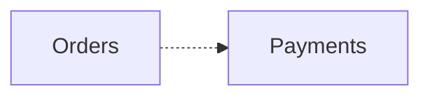

### Question 3

Does every UML Package have to represent a physical folder in the source code?

### Question 4

Consider:

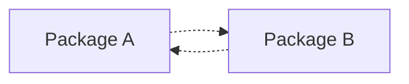

What problem might this design create?

### Question 5

A Python module inside `orders` imports and uses a function from `payments`.

Which package depends on which?

### Question 6

What is the difference between a Class Diagram and a Package Diagram?

<details>
<summary>Show Answers</summary>

1. To show how a system is organized into packages and how those packages depend on one another.
2. Orders depends on Payments.
3. No. UML Packages are logical groupings and do not have to correspond to physical directories.
4. It creates a circular dependency, which may increase coupling and maintenance difficulty.
5. The Orders package depends on the Payments package.
6. A Class Diagram focuses on classes and their relationships. A Package Diagram focuses on packages, organization, and dependencies.

</details>

---

## 15. Key Takeaways

- A Package Diagram is a UML structural diagram.
- Packages organize related model elements.
- A package can contain classes, interfaces, and other packages.
- Packages do not necessarily correspond to source-code folders.
- Dependency describes reliance between elements.
- A Dependency is drawn with a dashed line and an open arrowhead in UML.
- The arrow points toward the element being depended on.
- Circular dependencies can increase software complexity.
- Package Diagrams help us understand logical software organization.
- Package Access and Package Import provide additional rules for visibility between packages.

---

**Next Lesson:** [Package Access vs. Import](./access-vs-import.md) 

We will learn the difference between `«access»` and `«import»`, how public elements are shared between packages, and what transitive visibility means.